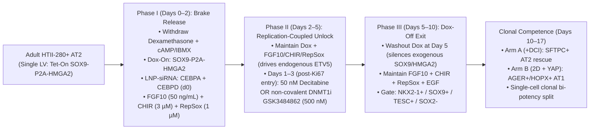

# Actionable Experimental Candidates for Adult Human Alveolar AT2 → Distal Tip Partial Reprogramming (`scMagnify × scElixir`)

> [!IMPORTANT]
> **Epistemic Status & Primary-Evidence Framing**: All **16** transcription factor (TF), chromatin-modifier, and plasma-membrane receptor interventions in this dossier represent **mechanistically constrained in-silico hypotheses** derived by integrating stabilized multi-scale neural Granger causality ([`01_run_scelixir_lung_scmagnify.py`](file:///home/antigravity/thejimmychai/scMagnify-private/scelixir_lung/01_run_scelixir_lung_scmagnify.py) & [`03_backfill_scmagnify_lung_vignettes.py`](file:///home/antigravity/thejimmychai/scMagnify-private/scelixir_lung/03_backfill_scmagnify_lung_vignettes.py)), paired ATAC–RNA `TF → cCRE → Target` enhancer networks ([`v200_cis_peak_gene_correlations.csv`](file:///home/antigravity/thejimmychai/scMagnify-private/scelixir_lung/vignette_output/scmagnify/tables/v200_cis_peak_gene_correlations.csv)), cross-species mouse multiome conservation ([`mouse_human_conservation_q2.csv`](file:///home/antigravity/thejimmychai/scMagnify-private/scelixir_lung/results/mouse_human_conservation_q2.csv)), `LSO-Ridge` linear set-optimization ([`03_1factor_embryonic_tip.csv`](file:///home/antigravity/data_workspace/scelixir_prior/prior_tables/03_1factor_embryonic_tip.csv) & [`03_pareto_frontier_embryonic_tip.csv`](file:///home/antigravity/data_workspace/scelixir_prior/prior_tables/03_pareto_frontier_embryonic_tip.csv)), `PertFormer 3B` foundation-model readouts ([`distaltf_fate_proximity_readout.json`](file:///home/antigravity/thejimmychai/scElixir_Claude_Hackerthon/data/reference/distaltf_fate_proximity_readout.json)), and `LINCS / Tahoe / SiPer` chemical-perturbation screens ([`AT2_to_TiP_compounds.csv`](file:///home/antigravity/thejimmychai/scElixir_Claude_Hackerthon/data/reference/AT2_to_TiP_compounds.csv)). Every statement and candidate below links directly to its **primary vignette graph and raw source table**; direct causal sufficiency, optimal stoichiometry, and tumorigenicity boundaries **require prospective experimental validation** in primary human adult `HTII-280+` AT2 organoids and precision-cut lung slices (PCLS).

---

## 1. Executive Summary: Why Lag-Scheduled Lung Pioneers Outperform Static Cocktails & `OSKM`

Reversing mature adult alveolar type 2 (`AT2`) cells toward a bi-potent embryonic/fetal distal tip progenitor state (`SOX9+ / ETV5+ / NKX2-1+ / TESC+ / CPM+`, analogous to `5–16 PCW` human bud-tip progenitors) faces three biological barriers that static pooled GRNs (`SCENIC+`) could not resolve simultaneously:

1. **Temporal Ordering of Chromatin Opening vs Lineage Anchoring**:
   - Under zero-bias `scMagnify` inference with context-active gating ([`q1_timepoint_masters_vs_scenicplus.csv`](file:///home/antigravity/thejimmychai/scMagnify-private/scelixir_lung/results/q1_timepoint_masters_vs_scenicplus.csv)), fetal distal-tip pioneers **`HMGA2`** (`T1` $\tau = 2.83$, mean $\tau = 2.66$, conserved in mouse $\tau = 3.58$; **completely silenced to `0` targets in perinatal `T3` and adult `T4`**) and **`SOX9`** (`T1` $\tau = 2.66 \to T2\;\tau = 2.74$, `64–65` targets; **silenced to `0` targets in adult `T4`**) act strictly during pseudoglandular/canalicular chromatin opening ([Vignette V300-1: Adult Pruning](file:///home/antigravity/thejimmychai/scMagnify-private/scelixir_lung/vignette_output/scmagnify/08_scm_v300_rna_vs_mlm_activity_dotplot_violin.png) · [Vignette V300-4: T1 vs T4 Dumbbell](file:///home/antigravity/thejimmychai/scMagnify-private/scelixir_lung/vignette_output/scmagnify/11_scm_v300_epoch_and_lineage_dumbbellplot.png)).
   - Conversely, **`ETV5`** (`T1` $\tau = 2.78 \to T3\;\tau = 3.07 \to T4\;\tau = 3.57$, mean $\tau = 3.10$, `97–114` targets vs only `21` underpowered targets in static [`AT2_to_TiP_TF_recipe.csv`](file:///home/antigravity/thejimmychai/scElixir_Claude_Hackerthon/data/reference/AT2_to_TiP_TF_recipe.csv); `78` targets in standalone pure-ATAC ablation [Vignette V200-3](file:///home/antigravity/thejimmychai/scMagnify-private/scelixir_lung/vignette_output/scmagnify/07_scm_v200_pure_atac_vs_hybrid_basal_ablation.png)) persists across all `4/4` epochs downstream of `FGF10–FGFR2` and `NRG1–ERBB2` ([Vignette V500-1](file:///home/antigravity/thejimmychai/scMagnify-private/scelixir_lung/vignette_output/scmagnify/19_scm_v500_five_panel_cci_alluvial_matrixplot.png)), bridging distal tips and adult `AT2` cells while preserving `NKX2-1` lung identity.
2. **Resolution of the Corticosteroid Maturation Lock ("Steroid Paradox")**:
   - Unconstrained cancer-line `LINCS` signature reversal ranked glucocorticoid receptor (`NR3C1`) agonists **`budesonide` (#5, `suppress_AT2 = 46.2`), `triamcinolone` (#10), and `dexamethasone` (#18)** among top hits ([`AT2_to_TiP_compounds.csv`](file:///home/antigravity/thejimmychai/scElixir_Claude_Hackerthon/data/reference/AT2_to_TiP_compounds.csv) · [Prior Vignette: SiPer Compound Ranking](file:///home/antigravity/thejimmychai/scElixir_Claude_Hackerthon/docs/vignette_output/prior_highlights/prior_20_lincs_siper_compound_ranking.png)).
   - In primary lung development, however, `scMagnify` Module `500` ([`lung_rtf_signaling_cascades.csv`](file:///home/antigravity/thejimmychai/scMagnify-private/scelixir_lung/results/lung_rtf_signaling_cascades.csv) · [Vignette V500-2: Steroid-Lock Cascades](file:///home/antigravity/thejimmychai/scMagnify-private/scelixir_lung/vignette_output/scmagnify/20_scm_v500_rtf_stripplot_and_cascade_trends.png)) + adult `HuBMAP` snATAC (`11,486` nuclei, [`02_atac_lifespan_tf_means.csv`](file:///home/antigravity/data_workspace/scelixir_prior/prior_tables/02_atac_lifespan_tf_means.csv) · [Prior Vignette: 57-Yr ATAC Lock-In](file:///home/antigravity/thejimmychai/scElixir_Claude_Hackerthon/docs/vignette_output/prior_highlights/prior_13_scipy_atac_lifespan_lockin.png)) prove that **`NR3C1`** (`T3` perinatal surge $\tau = 3.45$, `74` targets) and **`CD74 / CD44 → CEBPD`** (`cov = 0.513 / 0.375, q = 0.0017`; `T3` $\tau = 3.47$, `T4` $\tau = 2.84$, `affinity_AT2 = 3.632`) + **`CEBPA`** (`T3` $\tau = 2.85$, `84` targets) **lock in perinatal/adult surfactant maturation** (`SFTPC, SFTPB, ABCA3, LAMP3`). Consistent with this, `CEBPD_KO` is the **#1 single-factor `LSO-Ridge` unlocker** (`REI = 0.0984`, `delta_cosine = +0.1146`; [`03_1factor_embryonic_tip.csv`](file:///home/antigravity/data_workspace/scelixir_prior/prior_tables/03_1factor_embryonic_tip.csv) · [Prior Vignette: CellOracle Quiver](file:///home/antigravity/thejimmychai/scElixir_Claude_Hackerthon/docs/vignette_output/prior_highlights/prior_10_celloracle_quiver_perturbations.png)). Standard human AT2 `CK+DCI` media contain `50 nM dexamethasone` (`D` in `DCI`), which actively antagonizes tip dedifferentiation and must be **withdrawn** during Phase I–II induction.
3. **Elimination of Proximal `SOX2+` Club/Squamous & Pluripotency Drift (Focal vs Global Metrics)**:
   - In [`04_oskm_summary.json`](file:///home/antigravity/data_workspace/scelixir_prior/prior_tables/04_oskm_summary.json) ([Prior Fig. 6: OSKM vs Lung-TF Audit](file:///home/antigravity/thejimmychai/scElixir_Claude_Hackerthon/docs/vignette_output/prior_highlights/prior_18_oskm_vs_lungtf_comparison.png)), sustained Yamanaka `OSKM` fails to recover distal tip identity (**`9.3%` focal tip-marker direction recovery**, `tip_cosine_gain = -0.0186`, and only **`0.75%` global transcriptome gap closure**) while incurring a **628× higher off-target burden** (`1.2560` vs `0.0020` for `LungTF_Optimal_Tip`, which achieves **`93.0%` focal tip-marker direction recovery**, `+0.4670` `tip_cosine_gain`, and **`21.4%` global transcriptome gap closure**; corroborated orthogonally by `PertFormer 3B` `1.93×` human fate-proximity advantage in [`distaltf_fate_proximity_readout.json`](file:///home/antigravity/thejimmychai/scElixir_Claude_Hackerthon/data/reference/distaltf_fate_proximity_readout.json) · [Prior Vignette: PertFormer](file:///home/antigravity/thejimmychai/scElixir_Claude_Hackerthon/docs/vignette_output/prior_highlights/prior_17_pertformer_human_vs_mouse.png)). Note that fetal bud-tip reactivation also carries a shared developmental endoderm shift (`prox_cosine_gain = +0.1882`), requiring strict `SOX2- / KRT5-` monitoring because `SOX2` (`p_Club = 0.79`, `affinity_Club = 2.559`) drives `0.1718` proximal/squamous metaplasia in `OSKM`.

---

## 2. Streamlined Low-Payload Three-Phase Protocol (Primary Adult Human `HTII-280+` AT2 Organoids)

To avoid lentiviral multiplicity-of-infection (`MOI`) toxicity, quiescent `G0` S-phase-drug failure, and oncogene-induced senescence in aged adult human donor `AT2` cells, the wet-lab delivery architecture ([Figure 5](file:///home/antigravity/thejimmychai/scElixir_Claude_Hackerthon/docs/figures_scmagnify/fig5_interdisciplinary_reprogramming_and_signaling.png)) is streamlined to **a single inducible bicistronic lentivirus (`Tet-On SOX9-P2A-HMGA2`, `MOI <= 2`) + non-viral `LNP-siRNA` (`CEBPA + CEBPD`) + endogenous `FGF10 → FGFR2 → ETV5` niche activation** (reserving `MYCN` strictly as an optional secondary proliferation rescue arm):

---

## 3. Prioritized Master Portfolio of All 16 Actionable Candidates (With Primary Evidence Links)

Every metric below is synchronized 1:1 with [`actionable_candidates_scmagnify.csv`](file:///home/antigravity/thejimmychai/scMagnify-private/scelixir_lung/results/actionable_candidates_scmagnify.csv) (`16` rows), [`q1_timepoint_masters_vs_scenicplus.csv`](file:///home/antigravity/thejimmychai/scMagnify-private/scelixir_lung/results/q1_timepoint_masters_vs_scenicplus.csv), [`q2_persistent_identity_regulators.csv`](file:///home/antigravity/thejimmychai/scMagnify-private/scelixir_lung/results/q2_persistent_identity_regulators.csv), and [`03_1factor_embryonic_tip.csv`](file:///home/antigravity/data_workspace/scelixir_prior/prior_tables/03_1factor_embryonic_tip.csv).

### Tier 1: Core Distal-Tip Pioneer Activators (`Candidates #1–#4`)

| Rank | Candidate | Q2 Program | Streamlined Delivery & Window | `scMagnify` Multi-Scale Evidence & Vignette | Cross-Pipeline Support & Primary Evidence | Primary Organoid Readouts |
| :-: | :--- | :--- | :--- | :--- | :--- | :--- |
| **1** | **`SOX9`** | `Distal_Tip_Progenitor_Driver` | **Bicistronic `Tet-On SOX9-P2A-HMGA2`** (`Days 0–5` Dox-On; endogenous sustained `d5–10`) | Mean $\tau = 2.44$ (`T1` $\tau = 2.66$, `T2` $\tau = 2.74$, `T1 cent = 0.2167`; **`T4 cent = 0.0000`, `0` adult targets**) · [V300-1](file:///home/antigravity/thejimmychai/scMagnify-private/scelixir_lung/vignette_output/scmagnify/08_scm_v300_rna_vs_mlm_activity_dotplot_violin.png) · [V200-2 Logo](file:///home/antigravity/thejimmychai/scMagnify-private/scelixir_lung/vignette_output/scmagnify/06_scm_v200_hocomoco_tf_motif_seqlogos.png) | `SCENIC+` `197` tgs; `LSO-Ridge` #8 (`REI = 0.0620`); mouse `m_tau = 3.69` (`0.000` in `M_Club`) · [PertFormer](file:///home/antigravity/thejimmychai/scElixir_Claude_Hackerthon/docs/vignette_output/prior_highlights/prior_17_pertformer_human_vs_mouse.png) · [`03_1factor`](file:///home/antigravity/data_workspace/scelixir_prior/prior_tables/03_1factor_embryonic_tip.csv) | Endogenous `SOX9 3'UTR`, `TESC, CPM, SFTA3` induction; branching bud-tip lumen morphology. |
| **2** | **`HMGA2`** | `Distal_Tip_Progenitor_Driver` | **Bicistronic `Tet-On SOX9-P2A-HMGA2`** (**Strict `Dox-Off` washout at `Day 5`**) | Mean $\tau = 2.66$ (`T1` $\tau = 2.83$, `18` tgs; **silenced in `T3` & `T4 = 0.0000`**) · [V300-2 Trends](file:///home/antigravity/thejimmychai/scMagnify-private/scelixir_lung/vignette_output/scmagnify/09_scm_v300_rna_vs_grn_trend_grid.png) · [V100-4 Cascade](file:///home/antigravity/thejimmychai/scMagnify-private/scelixir_lung/vignette_output/scmagnify/04_scm_v100_pseudotime_cascade_heatmap.png) | **Missed by static `SCENIC+` recipe** (`3` tgs); `LSO-Ridge` #5 (`REI = 0.0756`; paralog `HMGA1` #4 overall / #2 OE activator `0.0844`); mouse `m_tau = 3.58` · [Pareto k*=4](file:///home/antigravity/thejimmychai/scElixir_Claude_Hackerthon/docs/vignette_output/prior_highlights/prior_11_scipy_kneedle_pareto_elbow.png) | scATAC opening at fetal `SOX9` (`chr17`) & `CPM` distal enhancers; verify transgene silence by `Day 7`. |
| **3** | **`MYCN`** | `Club_Secretory_Identity_Master` *(Fetal Growth)* | **Optional Secondary modRNA Pulse** (`Days 2–4` **ONLY** if donor `Ki67+ < 10%`) | Mean $\tau = 2.21$ (`T1` $\tau = 2.98$, `73` tgs, **`T4 cent = 0.0000`**) · [V300-1](file:///home/antigravity/thejimmychai/scMagnify-private/scelixir_lung/vignette_output/scmagnify/08_scm_v300_rna_vs_mlm_activity_dotplot_violin.png) | Replaces `c-MYC` from `OSKM` (`MYC_Only` yields `0.0%` tip recovery & `0.200` metabolic burden in [`04_oskm_summary.json`](file:///home/antigravity/data_workspace/scelixir_prior/prior_tables/04_oskm_summary.json)) · [OSKM Fig 6](file:///home/antigravity/thejimmychai/scElixir_Claude_Hackerthon/docs/vignette_output/prior_highlights/prior_18_oskm_vs_lungtf_comparison.png) | Colony-forming efficiency (`CFE`) rescue in aged donors without `p16/CDKN2A` oncogene arrest. |
| **4** | **`ETV5`** | `Distal_Tip_Progenitor_Driver` *(Tip→AT2 Bridge)* | **Driven Endogenously via `50 ng/mL FGF10` + `NRG1`** (optional CRISPRa backup) | Mean $\tau = 3.10$ (`T1` $\tau = 2.78 \to T4\;\tau = 3.57$, `p_AT2 = 0.57`) · [V300-3 Stripplot](file:///home/antigravity/thejimmychai/scMagnify-private/scelixir_lung/vignette_output/scmagnify/10_scm_v300_network_score_stripplot_and_rankplot.png) · [V500-1 CCI](file:///home/antigravity/thejimmychai/scMagnify-private/scelixir_lung/vignette_output/scmagnify/19_scm_v500_five_panel_cci_alluvial_matrixplot.png) | **Rescued by `scMagnify`** (`97–114` tgs vs `21` in static `SCENIC+`; `78` in pure-ATAC [V200-3](file:///home/antigravity/thejimmychai/scMagnify-private/scelixir_lung/vignette_output/scmagnify/07_scm_v200_pure_atac_vs_hybrid_basal_ablation.png)); `LSO-Ridge` #9 (`REI = 0.0594`); **#1 mouse `AT2` RSS (`0.570`)** | Preserves `NKX2-1` + distal alveolar competence (`p_Club = 0.17`); eliminates separate `ETV5` virus. |

---

### Tier 1B: Adult `AT2` Maturation Lock-In Brakes (`Candidates #5–#7`)

| Rank | Candidate | Q2 Program | Non-Viral Delivery & Window | `scMagnify` Multi-Scale Evidence & Vignette | Cross-Pipeline Support & Primary Evidence | Primary Organoid Readouts |
| :-: | :--- | :--- | :--- | :--- | :--- | :--- |
| **5** | **`CEBPA`** | `AT2_Identity_Master` | **Transient `LNP-siRNA` (`25 nM`, `Day 0`)** (decays naturally by `Day 5` to permit re-maturation) | Mean $\tau = 2.48$ (`T3` $\tau = 2.85$, `84` tgs; `p_AT2 = 0.51`) · [V400-6 SFTPC Browser](file:///home/antigravity/thejimmychai/scMagnify-private/scelixir_lung/vignette_output/scmagnify/18_scm_v400_native_genome_viewer_loci.png) · [V200-3](file:///home/antigravity/thejimmychai/scMagnify-private/scelixir_lung/vignette_output/scmagnify/07_scm_v200_pure_atac_vs_hybrid_basal_ablation.png) | `SCENIC+` `HIGH` `KNOCK OUT`; pure-ATAC `69` tgs; mouse `M_AT2 = 0.223` (`RSS = 0.476`) · [pySCENIC KO](file:///home/antigravity/thejimmychai/scElixir_Claude_Hackerthon/docs/vignette_output/prior_highlights/prior_08_pyscenic_perinatal_ko_screen.png) | Releases `SFTPC / SFTPB / ABCA3` lipid-surfactant arrest without permanent CRISPRi integration. |
| **6** | **`CEBPD`** | `AT2_Identity_Master` | **Transient `LNP-siRNA` (`25 nM`, `Day 0`, co-formulated with `siCEBPA`)** | Mean $\tau = 2.92$ (`T3` $\tau = 3.47$, **`T4 cent = 0.1416` — #1 non-stress adult `AT2` hub**, `p_AT2 = 0.53`) · [V500-2 Lock](file:///home/antigravity/thejimmychai/scMagnify-private/scelixir_lung/vignette_output/scmagnify/20_scm_v500_rtf_stripplot_and_cascade_trends.png) | **#1 `LSO-Ridge` single-factor unlocker** (`REI = 0.0984`, `Δcos = +0.1146` in [`03_1factor_embryonic_tip.csv`](file:///home/antigravity/data_workspace/scelixir_prior/prior_tables/03_1factor_embryonic_tip.csv)) · [CellOracle Quiver](file:///home/antigravity/thejimmychai/scElixir_Claude_Hackerthon/docs/vignette_output/prior_highlights/prior_10_celloracle_quiver_perturbations.png) | Controlled attenuation of mature lamellar-body quiescence (`SFTPA1, LAMP3`) while `NKX2-1` stays `>85%`. |
| **7** | **`NR3C1`** | `Pan_Lung_Lineage_Core` *(Steroid Lock)* | **Media Dexamethasone Withdrawal (`0 nM Dex`, `Days 0–10`)** $\pm$ `500 nM RU486` (`d0–2`) | Mean $\tau = 2.45$ (`T3` perinatal surge $\tau = 3.45$, `74` tgs; `T4 cent = 0.0639`) · [V500-2](file:///home/antigravity/thejimmychai/scMagnify-private/scelixir_lung/vignette_output/scmagnify/20_scm_v500_rtf_stripplot_and_cascade_trends.png) | **Resolves `LINCS` Steroid Paradox** ([`AT2_to_TiP_compounds.csv`](file:///home/antigravity/thejimmychai/scElixir_Claude_Hackerthon/data/reference/AT2_to_TiP_compounds.csv) · [SiPer Compounds](file:///home/antigravity/thejimmychai/scElixir_Claude_Hackerthon/docs/vignette_output/prior_highlights/prior_20_lincs_siper_compound_ranking.png)) | `>2.5×` increase in `SOX9+ / CPM+` bud-tip organoid emergence vs `+50 nM Dex` control. |

---

### Tier 2: Lineage-Identity Guardians & Epistasis Gates (`Candidates #8–#14`)

| Rank | Candidate | Q2 Program | Actionable Protocol Role | `scMagnify` & Prior Primary Evidence | Biological & Safety Rationale |
| :-: | :--- | :--- | :--- | :--- | :--- |
| **8** | **`NKX2-1`** | `Pan_Lung_Lineage_Core` | **Mandatory Positive Gate (`>=85%` nuclear IF/flow; NEVER inhibit)** | `4/4` epochs ($P = 0.625$, $\tau = 2.54$, `76/85/87` tgs) · [Fig. 4d Locus](file:///home/antigravity/thejimmychai/scElixir_Claude_Hackerthon/docs/figures_scmagnify/fig4_three_ring_egrns_and_locus_tracks.png) · [57-Yr ATAC](file:///home/antigravity/thejimmychai/scElixir_Claude_Hackerthon/docs/vignette_output/prior_highlights/prior_13_scipy_atac_lifespan_lockin.png) | Anchors pan-lung super-enhancers; loss triggers immediate `CDX2+ / TFF1+` gastric metaplasia. |
| **9** | **`FOXA2`** | `Club_Secretory_Identity_Master` *(Endoderm Pioneer)* | **Mandatory Endoderm Co-Anchor (Preserve endogenous; NEVER inhibit)** | Mean $\tau = 2.96$ (`T1` $\tau = 3.23$, `65/72/74` tgs; mouse `m_tau = 2.78`) · [V200-2 Logo](file:///home/antigravity/thejimmychai/scMagnify-private/scelixir_lung/vignette_output/scmagnify/06_scm_v200_hocomoco_tf_motif_seqlogos.png) · [V400-5 3-Ring](file:///home/antigravity/thejimmychai/scMagnify-private/scelixir_lung/vignette_output/scmagnify/17_scm_v400_native_grn_visualizer_triplet.png) | Co-occupies `NKX2-1` enhancers across all lung fates while regulating airway mucin homeostasis. |
| **10** | **`TFCP2L1`** | `AT2_Identity_Master` | **Alveolar Self-Renewal Competence Reporter (`Day 10–17` `DCI` rescue)** | Mean $\tau = 3.11$ (`T3` $\tau = 4.09$, `p_AT2 = 0.54`, **`Club = 0.0060`**) · [V300-5 Mouse](file:///home/antigravity/thejimmychai/scMagnify-private/scelixir_lung/vignette_output/scmagnify/12_scm_v300_scenicplus_audit_and_mouse_regvelo.png) · [`mouse_human_conservation_q2.csv`](file:///home/antigravity/thejimmychai/scMagnify-private/scelixir_lung/results/mouse_human_conservation_q2.csv) | High alveolar purity and **100% `AT2`-exclusive mouse activity** (`M_AT2 = 0.023` vs `0.000` `AT1/Club`, `RSS_AT2 = 0.494`). |
| **11** | **`TEAD1`** | `AT1_Identity_Master` | **Premature `AT1`-Flattening Gate** (Restrain nuclear `YAP/TEAD1` via 3D Matrigel + `RepSox`) | `4/4` epochs ($P = 0.676$, $\tau = 2.42$, adult ATAC `0.321`; mouse `M_AT1 = 0.282`) · [V400-6 AGER Browser](file:///home/antigravity/thejimmychai/scMagnify-private/scelixir_lung/vignette_output/scmagnify/18_scm_v400_native_genome_viewer_loci.png) | Stiff matrix or unrestrained `YAP/TEAD1` shunts plastic `AT2` cells into post-mitotic `AGER+` `AT1` arrest. |
| **12** | **`MYRF`** | `AT1_Identity_Master` | **Terminal `AT1` Morphogenesis Gate & `Arm B` Readout (`Day 17`)** | `4/4` epochs ($P = 0.735$, $\tau = 2.73$, `p_AT1 = 0.47`) · [Fig. 4b AGER 3-Ring](file:///home/antigravity/thejimmychai/scElixir_Claude_Hackerthon/docs/figures_scmagnify/fig4_three_ring_egrns_and_locus_tracks.png) · [V300-4 Dumbbell](file:///home/antigravity/thejimmychai/scMagnify-private/scelixir_lung/vignette_output/scmagnify/11_scm_v300_epoch_and_lineage_dumbbellplot.png) | Co-drives `AGER / CAV1` outer-ring `AT1` eGRN with `HOPX` ($P = 0.898$) & `TEAD1`. |
| **13** | **`SOX2`** | `Club_Secretory_Identity_Master` | **Strict Negative Exclusion Gate (`SOX2+ / KRT5+ < 5%`)** | Mean $\tau = 2.76$ (`T1` $\tau = 3.17$, **`T4 = 0.0000`**, `p_Club = 0.79`) · [V300-4](file:///home/antigravity/thejimmychai/scMagnify-private/scelixir_lung/vignette_output/scmagnify/11_scm_v300_epoch_and_lineage_dumbbellplot.png) · [OSKM Fig 6](file:///home/antigravity/thejimmychai/scElixir_Claude_Hackerthon/docs/vignette_output/prior_highlights/prior_18_oskm_vs_lungtf_comparison.png) | Primary culprit of `OSKM` / `SKM` bronchiolar & squamous off-target derailment (`0.1718–0.1794`). |
| **14** | **`EHF`** | `AT2_Identity_Master` *(Human `RAS ↔ AT2` Bridge)* | **Distal `SCGB3A2+` RAS Plasticity Monitor** (CRISPRi only if `SCGB3A2+ > 20%`) | `4/4` epochs ($P = 0.599$, `157/162/165` tgs, `RAS ATAC = 0.264`) · [V400-5 SCGB3A2 3-Ring](file:///home/antigravity/thejimmychai/scMagnify-private/scelixir_lung/vignette_output/scmagnify/17_scm_v400_native_grn_visualizer_triplet.png) · [V400-1 Circos](file:///home/antigravity/thejimmychai/scMagnify-private/scelixir_lung/vignette_output/scmagnify/13_scm_v400_native_circosplot_lineages.png) | Co-binds `SCGB3A2` cis-enhancers in human respiratory bronchioles (`M_AT2/AT1 = 0.000` in mouse). |

---

### Tier 3: Plasma-Membrane Niche Signaling & Replication-Coupled Epigenetic Adjuvants (`Candidates #15–#16`)

| Rank | Candidate | Target / Cascade | Recommended Regimen & Timing | Mechanistic Rationale & Primary Evidence | Safety / Toxicity Boundary |
| :-: | :--- | :--- | :--- | :--- | :--- |
| **15** | **`FGFR2` (`FGF10` + `CHIR99021`)** | `FGF10 → FGFR2 → FOXP2 / FOXP1 / ETV5` + `GSK3Bi → LEF1` | **`50 ng/mL FGF10` + `3 µM CHIR99021`** (`Days 0–10`) | Top `infer_signal_pairs` cascade (`FGF10–FGFR2–FOXP2` `cov = 0.371, q = 0.0017`; `NRG1–ERBB2–ETV5` `q = 0.0017` in [`lung_rtf_signaling_cascades.csv`](file:///home/antigravity/thejimmychai/scMagnify-private/scelixir_lung/results/lung_rtf_signaling_cascades.csv)) · [V500-1](file:///home/antigravity/thejimmychai/scMagnify-private/scelixir_lung/vignette_output/scmagnify/19_scm_v500_five_panel_cci_alluvial_matrixplot.png) · [V500-2](file:///home/antigravity/thejimmychai/scMagnify-private/scelixir_lung/vignette_output/scmagnify/20_scm_v500_rtf_stripplot_and_cascade_trends.png) | Keep `CHIR99021 <= 3 µM`; `>6 µM` without `FGF10` risks non-lung mesendoderm drift. |
| **16** | **`TGFBR2` (`RepSox` + Replication-Coupled `DNMT1i`)** | `TGFBR1/2 → SMAD3` Blockade + S-Phase Epigenetic Unlock | **`1 µM RepSox`** (`Days 0–10`) + **`50 nM Decitabine` at `Days 1–3`** *(or catalytic `DNMT1i GSK3484862`, `500 nM`)* | `RepSox` blocks `TGFBR2 → SMAD3` (`T1` $\tau = 1.96$, `97` tgs); delaying `Decitabine` (`induce_TiP = 109.8` in [`AT2_to_TiP_compounds.csv`](file:///home/antigravity/thejimmychai/scElixir_Claude_Hackerthon/data/reference/AT2_to_TiP_compounds.csv)) to `Days 1–3` ensures `Ki67+` S-phase entry · [Dynamo LAP](file:///home/antigravity/thejimmychai/scElixir_Claude_Hackerthon/docs/vignette_output/prior_highlights/prior_15_dynamo_least_action_path.png) · [SiPer Compounds](file:///home/antigravity/thejimmychai/scElixir_Claude_Hackerthon/docs/vignette_output/prior_highlights/prior_20_lincs_siper_compound_ranking.png) | Never apply `>200 nM` `Decitabine` at `Day 0` in quiescent `G0` `AT2` cells. |

---

## 4. Three Mandatory Prospective Experimental Controls & Go/No-Go Gates

> [!WARNING]
> Because `FGF10 + CHIR99021 + RepSox` ("3F" human bud-tip niche media) combined with `Dexamethasone` withdrawal can partially upregulate `SOX9` and downregulate `SFTPC` on its own, **three experimental controls are mandatory** to prove true epigenetic reversal rather than transient media-induced transcriptional plasticity:

1. **Control 1 — Niche-Media + Empty-Vector + Non-Targeting `LNP-siRNA` Baseline (`Days 0–10`)**: Quantifies how much `SOX9 / ETV5 / CPM` induction is achieved by `Dex-free FGF10 + CHIR99021 + RepSox` alone vs `+ Tet-On SOX9-P2A-HMGA2 + siCEBPA/CEBPD` (requiring `>=2.5×` gain in distal `SOX9/CPM` ATAC-seq enhancer accessibility over niche-media alone).
2. **Control 2 — Phase III `+50 nM Dexamethasone (DCI)` Functional Rescue Gate (`Days 10–17`)**: Distinguishes reversible bi-potent tip competence from permanent `siCEBPA/CEBPD`-mediated surfactant loss; washed-out `Day 10` tip organoids returned to `DCI` must restore **`>=60% Pro-SFTPC+ / HTII-280+` mature lamellar-body `AT2` cells**.
3. **Control 3 — Single-Cell Clonal Bi-Potency Split Assay (`Days 10–17`)**: FACS-sort individual `Day 10` `CPM+ / NKX2-1+` reverted cells (`1 cell/well` or lentiviral static barcode) and split sister progeny into `Arm A` (`+DCI` 3D Matrigel) vs `Arm B` (`2D + 10% FBS / YAP-activating` stiffness) to prove **single-cell clonal generation of both `SFTPC+` `AT2` and `AGER+ / HOPX+ / MYRF+` `AT1` progeny** (ruling out pre-existing mixed subsets).

| Assay Stage | Day | Modality | Quantitative **GO** Criterion | **NO-GO / Safety Abort** Trigger |
| :--- | :-: | :--- | :--- | :--- |
| **Baseline QC** | `Day 0` | Flow + IF (`HTII-280, NKX2-1, SFTPC`) | `>=90% HTII-280+ / NKX2-1+` primary adult human `AT2` (`>=3` biological donors) | `>5% EPCAM-` mesenchymal or `SOX2+` airway contamination |
| **Chromatin Unlock** | `Day 4` | scATAC-seq + EdU/Ki67 + RT-qPCR | `>=2.5×` gain in `SOX9` (`chr17`) & `CPM` (`chr12`) cCRE accessibility over **Control 1**; `50–75%` drop in `SFTPC/LAMP3` | `NKX2-1+` drops `<80%` or `Cleaved-Caspase-3+ > 15%` |
| **Tip Identity Peak** | `Day 8–10` | 10x Multiome (`snRNA + snATAC`) | `>=35%` `NKX2-1+ / SOX9+ / ETV5+ / TESC+ / CPM+` cells; `>= +0.30` focal tip cosine gain & `>= 15%` global gap closure | `>5%` `SOX2+ / KRT5+` squamous, `>2%` `CDX2+` gastric, or exogenous `SOX9-P2A-HMGA2` persisting after `Day 6` Dox washout |
| **Clonal Competence** | `Day 17` | Clonal Split IF + TEM (`Control 2 & 3`) | `>=60% Pro-SFTPC+` lamellar bodies in `+DCI` & `>=40% AGER+ / HOPX+` flat `AT1` cells from single `CPM+` clones | Failure to re-induce `SFTPC` in `+DCI` (indicates irreversible alveolar dedifferentiation arrest) |
