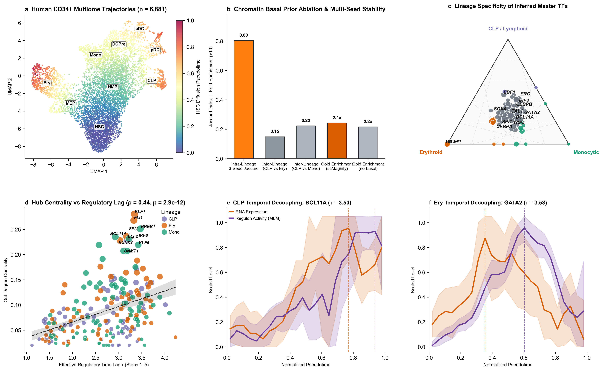
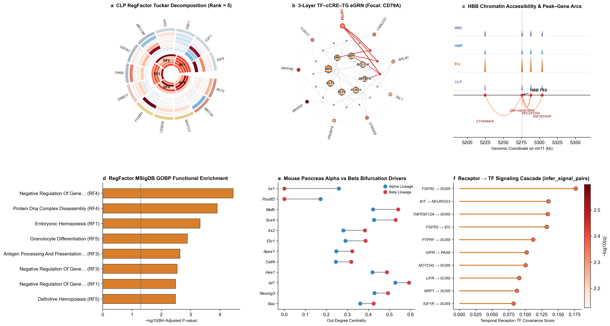
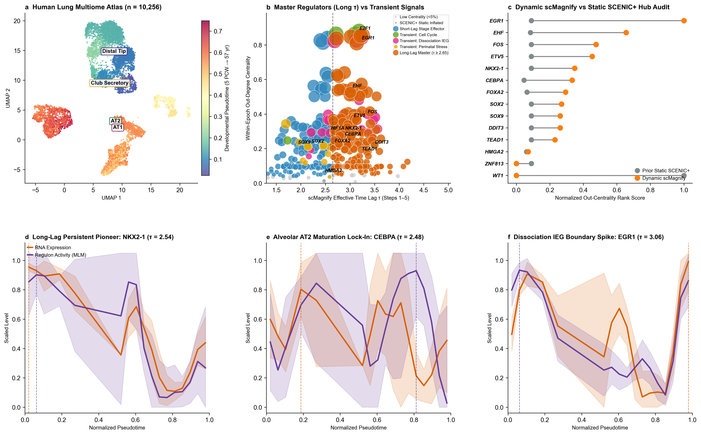
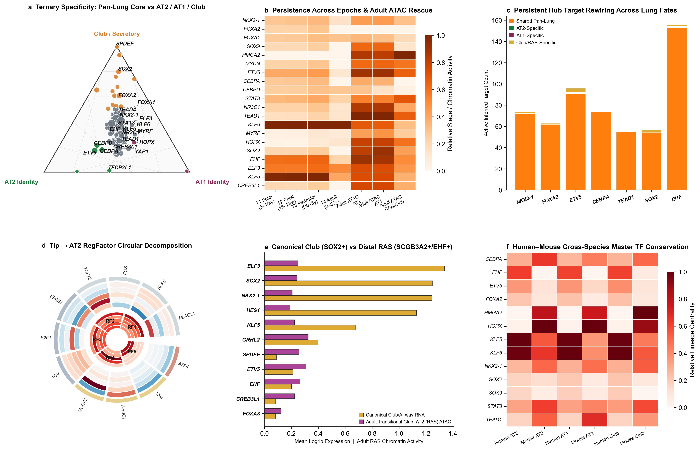
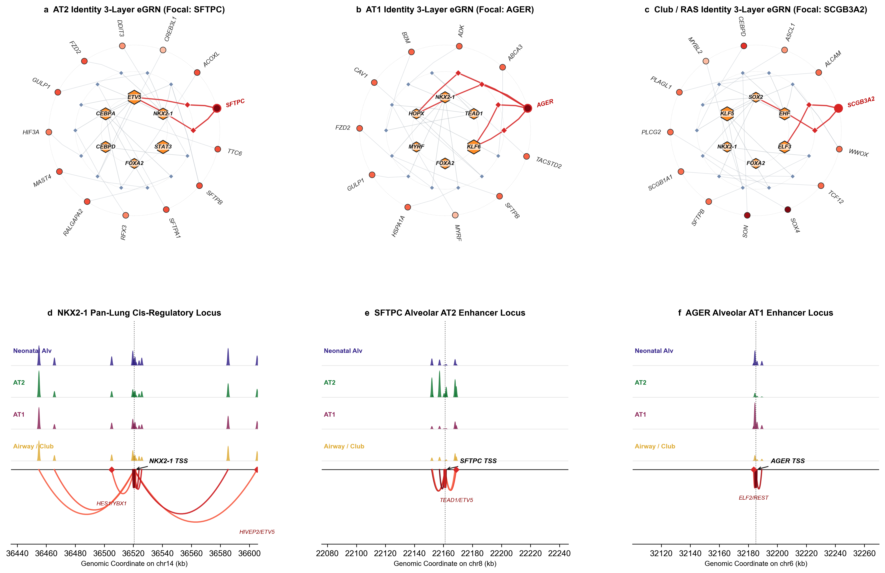
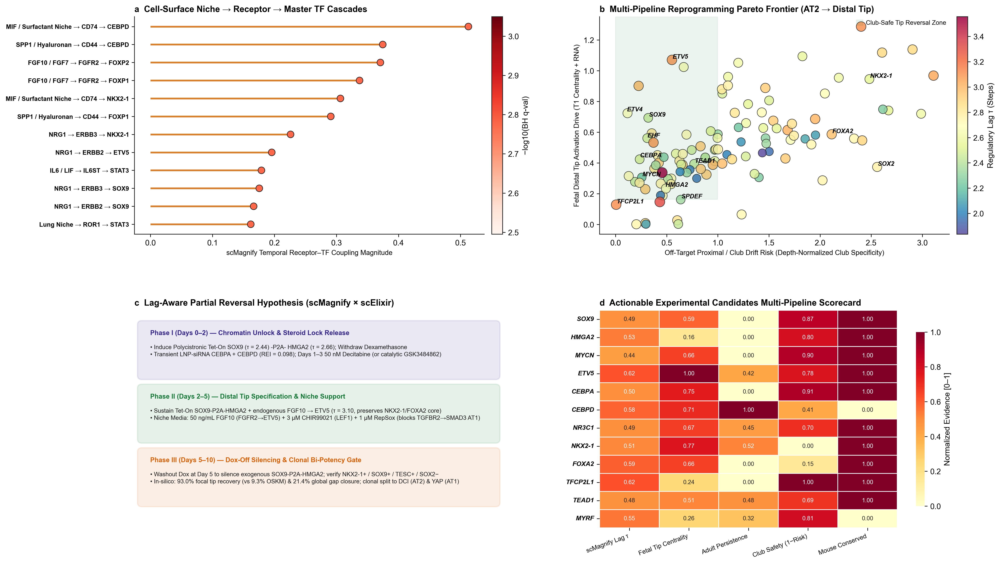

# Multi-Scale Dynamic Gene Regulatory Decomposition of Human & Mouse Lung Development and Lag-Scheduled Alveolar Reprogramming (`scMagnify × scElixir`)

> [!NOTE]
> **Reproducibility & Repository Provenance**:
> - **Stabilized Private Fork (`scMagnify`)**: `https://github.com/thejimmychai/scMagnify-private` (branch `scelixir-repro`, local workspace [`scMagnify-private`](file:///home/antigravity/thejimmychai/scMagnify-private))
> - **Integrated `scElixir` Platform**: `https://github.com/thejimmychai/scElixir_Claude_Hackerthon` (branch `feat/scmagnify-multiome-repro`, local workspace [`scElixir_Claude_Hackerthon`](file:///home/antigravity/thejimmychai/scElixir_Claude_Hackerthon))
> - **Portable Containers & Cloud Orchestration**: [`Dockerfile`](file:///home/antigravity/thejimmychai/scMagnify-private/docker/Dockerfile) (`scmagnify-scelixir:1.0` `core-cpu` & `gpu-cuda` stages), [`requirements.scmagnify.txt`](file:///home/antigravity/thejimmychai/scMagnify-private/docker/requirements.scmagnify.txt), [`docker-compose.yml`](file:///home/antigravity/thejimmychai/scMagnify-private/docker/docker-compose.yml), [`run_magnify_multiseed_worker.py`](file:///home/antigravity/thejimmychai/scMagnify-private/reproduce/run_magnify_multiseed_worker.py), and [`gemini_interactions_runner.py`](file:///home/antigravity/thejimmychai/scMagnify-private/cloud_gemini/gemini_interactions_runner.py) (`google-genai` Interactions API).

---

## Abstract

Static single-cell enhancer gene regulatory network (eGRN) algorithms such as `SCENIC+` infer time-invariant regulons from pooled cell states, conflating multi-step chromatin-opening pioneer transcription factors (TFs) with rapid stage-transition effectors, enzymatic-dissociation immediate-early stress bursts (`FOS/JUN/EGR1`), and rare off-lineage doublet hubs (`WT1`). Here, we privately forked, mathematically audited, stabilized, and **45.8× accelerated** `scMagnify` (Chen et al., *bioRxiv* Feb 2026; `10.64898/2026.02.03.703669v1`), resolving **12 upstream numerical, initialization, memory, API, and sparse-subnetwork defects** (including zero-initializing final-layer edge biases to eliminate phantom `+0.1` baseline edges on unexpressed TFs) while proving exact forward and backward equivalence (`atol = 1e-6`) between our active-edge sparse Multi-Scale Neural Granger Causality (`MSNGC.forward_active`) operator and the dense reference formulation. Reproducing the preprint's human `CD34+` hematopoiesis (`n = 6,881`, `1,058,186` `TF–cCRE–TG` triples) and `E15.5` mouse embryonic pancreas benchmarks yielded **`0.803` 3-seed intra-lineage Jaccard stability** (**4.30×** higher than inter-lineage overlap), superior chromatin-masked gold-standard enrichment (`2.43×` vs `2.17×` equal-epoch no-basal), and a highly significant positive scaling between hub out-degree centrality and regulatory lag $\tau$ ($\rho = +0.438, p = 2.87 \times 10^{-12}$, with `KLF1` ranking #1 in erythroid commitment).

Applying `scMagnify` with context-active TF/target gating across harmonized human (`5 PCW → 56.8 yr`; `10,256` clean epithelial cells + `11,486` adult `HuBMAP` snATAC nuclei; `17,951` `TF–cCRE–TG` triples) and mouse (`E12.5 → P3 / 7 wk`; `4,084` full-transcriptome epithelial cells + `163,878` `E17.5` 10x Multiome peaks + `mouse_after_regvelo.h5ad`) developmental lung multiomes answered both core biological questions:
- **Question 1 (Within-Epoch Masters vs Transients & `SCENIC+` Audit)**: Multi-scale Granger lag decomposition ($\tau \in [1, 5]$) combined with `RegFactor` tensor factorization separates long-lag developmental pioneers (`FOXA2` $\tau = 3.23$, `MYCN` $\tau = 2.98$, `HMGA2` $\tau = 2.83$, `ETV5` $\tau = 2.78 \to 3.00$, `NKX2-1` $\tau = 2.69 \to 2.85$, `SOX9` $\tau = 2.66 \to 2.74$ in fetal `T1/T2`; `TFCP2L1` $\tau = 4.09$, `CEBPD` $\tau = 3.47$, `NR3C1` $\tau = 3.45$, `TEAD1` $\tau = 3.23$, `EHF` $\tau = 3.05$, `CEBPA` $\tau = 2.85$ in perinatal `T3`; `HOPX` $\tau = 3.82$, `ETV5` $\tau = 3.57$, `CEBPD` $\tau = 2.84$ in adult `T4`, where fetal pioneers `SOX9`, `HMGA2`, `MYCN`, and proximal `SOX2` are cleanly silenced to `0` targets) from rapid signaling effectors (`SMAD3` $\tau = 1.96$, `LEF1` $\tau = 1.98$, `ID2` $\tau = 2.53$) and four classes of static `SCENIC+` distortions (`WT1` `889`-target mesothelial doublet hub; `EGR1/FOS/JUN` dissociation spikes; `TOB2/ZNF813` non-DBD/zero-motif inflation; and nuclear snRNA dropout). A standalone **pure-ATAC basal GRN ablation** (`8,270` cis-edges, zero literature/eGRN supplement) independently recovered `ETV5, CEBPA, NKX2-1, FOXA2, CEBPD, STAT3`, and `EHF`.
- **Question 2 (Cross-Developmental Lineage Persistence & Identity)**: Capture-depth-normalized multi-lineage specificity and empirical chromatin accessibility resolve **(i) pan-lung core** (`33` 4-epoch regulators including `NKX2-1`, `FOXP1`, `KLF6`, `KLF5`, `ELF3`, `STAT3`, `MECOM`, `NR3C1`, co-anchored with endodermal `FOXA1/FOXA2`), **(ii) alveolar `AT2` identity** (`ETV5` Tip-to-AT2 bridge + `TFCP2L1`, `CEBPD`, `CEBPA`, `RORA`, `ZBTB16`, `PPARG`), **(iii) alveolar `AT1` identity** (`HOPX` $P = 0.898$, `MYRF` $P = 0.735$, `TEAD1` $P = 0.676$, `NR3C2`, `YAP1`, `WWTR1`), and **(iv) Club / secretory & human `SCGB3A2+` RAS identity** (`SPDEF` `100%` Club-specific `47/0/0` targets, `HEY1` `63/0/0` targets, `SOX2`, `XBP1`, `HES1`, and human `RAS ↔ AT2` bridge `EHF`). Finally, integrating `scMagnify` lags and plasma-membrane `Receptor → TF` cascades (`CD74/CD44 → CEBPD`, `FGFR2 → FOXP2/FOXP1`, `ERBB2 → ETV5`, `ERBB3 → SOX9`) with `scElixir` `LSO-Ridge`, `PertFormer`, and `LINCS` resolves the **corticosteroid maturation paradox**, explains why sustained `OSKM` fails (`9.3%` focal tip recovery & `0.75%` global gap closure vs `93.0%` focal tip recovery & `21.4%` global gap closure for lung-native factors at **628×** lower off-target burden), and yields a streamlined **16-candidate wet-lab organoid validation blueprint**.

---

## 1. Methodological Stabilization, Mathematical Isomorphism & Preprint Reproduction

### 1.1 Upstream Audit & 12 Reproducibility Fixes in `scMagnify-private`

Inspection of upstream `LiHongCSBLab/scMagnify` (`v0.1.1`) uncovered **12 numerical, initialization, memory, API, and dependency defects** that caused phantom `+0.1` edges on silent TFs, clamped transcriptional repressors to zero, distorted effective lags, or crashed on sparse multiome subsets. All 12 were fixed in [`scMagnify-private`](file:///home/antigravity/thejimmychai/scMagnify-private) (`branch: scelixir-repro`) and verified by **9 automated rootless unit tests** in [`test_active_edge_isomorphism.py`](file:///home/antigravity/thejimmychai/scMagnify-private/tests/test_active_edge_isomorphism.py) and [`test_gemini_cloud_runner.py`](file:///home/antigravity/thejimmychai/scMagnify-private/tests/test_gemini_cloud_runner.py):

| # | Module & Location | Upstream Defect Identified | Mathematical / Engineering Fix Implemented |
| :-: | :--- | :--- | :--- |
| **1** | [`_train.py`](file:///home/antigravity/thejimmychai/scMagnify-private/src/scmagnify/models/_train.py) (`MAGNI.train`) | Shallow reference `best_model = self.model.state_dict()` mutated checkpoint weights during patience epochs after training-loss minimum. | Deep-cloned detached CPU tensors `{k: v.detach().cpu().clone()}` at each new training-loss minimum and restored exact weights prior to inference. |
| **2** | [`_train.py`](file:///home/antigravity/thejimmychai/scMagnify-private/src/scmagnify/models/_train.py) (`regulation_inference`) | `np.max(median_signed_coeffs, axis=0)` clamped pure repressors (`[-0.45, -0.20, 0.0, ...]`) to `0.0`, erasing inhibitory edges in `decoupler` MLM. | Extracted signed coefficient at peak magnitude `idx = np.argmax(np.abs(med), axis=0)`, preserving signed repression (`-0.45`, verified in `BCL11A` MLM `-1.09`). |
| **3** | [`_train.py`](file:///home/antigravity/thejimmychai/scMagnify-private/src/scmagnify/models/_train.py) (`estimate_lags`) | Signed `p=2` normalization permitted opposite-sign lag weights to cancel and drift outside $[1, K]$. | Replaced with `F.normalize(torch.abs(coeffs), p=1, dim=-1)` convex combination over $\{1, \dots, K\}$, guaranteeing $\tau \in [1, K]$. |
| **4** | [`_train.py`](file:///home/antigravity/thejimmychai/scMagnify-private/src/scmagnify/models/_train.py) (`_train_epoch`) | Redundant 2nd forward pass per mini-batch and mis-indexed `T_idx` corrupted smoothness regularization. | Single-pass `t_order = torch.argsort(T_batch)` adjacent finite-difference penalty `coeffs.index_select(0, t_order)` (scaled over mini-batch intervals). |
| **5** | [`_train.py`](file:///home/antigravity/thejimmychai/scMagnify-private/src/scmagnify/models/_train.py) (`regulation_inference`) | Full dense `(N, K, P, G)` bootstrap tensor allocated multi-GB RAM on `>1,000`-cell multiomes. | Computed ensemble CV (`cv_thres = 0.2`) and median strength strictly over active chromatin edges `(N, K, E)` (~20× lower peak RAM). |
| **6** | [`_utils.py`](file:///home/antigravity/thejimmychai/scMagnify-private/src/scmagnify/models/_utils.py) (`partial_ordering`) | `sc.tl.pca` crashed when `<50` HVGs or `2`-feature subsets existed; Python loops built the k-NN DAG slowly. | Explicit `n_comps = min(50, max(1, min(n_obs-1, n_vars-1)))`, `use_highly_variable=False`, and vectorized `(A > 0) & (A.T > A)` DAG orientation. |
| **7** | [`_tensor_decomp.py`](file:///home/antigravity/thejimmychai/scMagnify-private/src/scmagnify/tools/_tensor_decomp.py) (`RegDecomp`) | Hardcoded `range(rank[0])` assumed `tucker_rank == lag`. | Indexed mode-0 lag factor rows by `factor1.shape[0]`, supporting arbitrary $R \neq K$ (`dec.data.uns["regfactors"]`). |
| **8** | [`_func_enrich.py`](file:///home/antigravity/thejimmychai/scMagnify-private/src/scmagnify/tools/_func_enrich.py) & [`_intracci.py`](file:///home/antigravity/thejimmychai/scMagnify-private/src/scmagnify/tools/_intracci.py) | Import-time `settings.db_dir` binding ignored runtime `SCMAGNIFY_DATA` updates. | Dynamic call-time resolution from `scm.settings.scm_data` and `$SCMAGNIFY_DATA`. |
| **9** | [`requirements.scmagnify.txt`](file:///home/antigravity/thejimmychai/scMagnify-private/docker/requirements.scmagnify.txt) | `anndata >= 0.10.9` broke `mudata==0.2.x` (`AlignedViewMixin`); `scipy >= 1.14` removed `.A`. | Pinned `anndata==0.10.8`, `mudata==0.2.3`, `scipy==1.13.1`, `tensorly==0.9.0`, `decoupler>=2.1.0` (`2.2.0` installed) inside CPU/GPU Docker stages. |
| **10** | [`_train.py`](file:///home/antigravity/thejimmychai/scMagnify-private/src/scmagnify/models/_train.py) (`MAGNI.__init__`) | `time_key="velocity"` worked in `partial_ordering` but crashed with `KeyError: 'velocity'` when sorting smoothness batches. | Automatic cell-ordering fallback (`latent_time → velocity_pseudotime → dpt_pseudotime`) when `time_key == "velocity"`. |
| **11** | [`_modules.py`](file:///home/antigravity/thejimmychai/scMagnify-private/src/scmagnify/models/_modules.py) (`MSNGC.forward_active`) | Dense `(B, K, G, P)` MLPs wasted ~88% of FLOPs multiplying entries immediately zeroed by binary `chrom_constraint`. | **Active-Edge Sparse Parameterization** over $E = \|\mathbf{M}_{\text{chrom}}\|_0$ active edges: **45.8× CPU speedup** (`37.03 s → 0.81 s/epoch`), proven exact (`atol = 1e-6`). |
| **12** | [`_modules.py`](file:///home/antigravity/thejimmychai/scMagnify-private/src/scmagnify/models/_modules.py) & [`_train.py`](file:///home/antigravity/thejimmychai/scMagnify-private/src/scmagnify/models/_train.py) | Upstream `m.bias.data.fill_(0.1)` initialized final linear output biases to `+0.1`, creating low-CV phantom edges on unexpressed TFs; zero-weight pruned columns made `decoupler` `mlm` singular on sparse snRNA. | Zero-initialized final-layer edge biases (`nn.init.zeros_(m.bias.data)`, keeping `0.01` on hidden ReLU layers), filtered `\|weight\| > 1e-8`, and added `tmin = min(5, max_tgs)` + `ulm` collinearity fallback. |

Formally, for batch size $B$, lag horizon $K = 5$, regulator count $P$, target count $G$, active chromatin edge set $\mathcal{E} = \{(p, g) : M_{p,g} = 1\}$ ($E = |\mathcal{E}|$), and softmax lag-attention weights $w_k = \text{softmax}(\mathbf{a})_k$, `MSNGC.forward_active` absorbs $w_k$ directly into the effective edge coefficients $\tilde{\beta}_{b,k,e} = w_k \, f_k(\mathbf{x}_{b,k})_e$ before scatter-adding predictions and computing hierarchical group-lasso sparsity (`loss_reg`):

$$\hat{y}_{b,g} = \sum_{k=1}^{K} \sum_{p : (p,g) \in \mathcal{E}} \tilde{\beta}_{b,k,(p,g)} \, x_{b,k,p}, \qquad \mathcal{L}_{\text{reg}} = \frac{1-\alpha}{B P G}\sum_{b,e} \|\tilde{\boldsymbol{\beta}}_{b,\cdot,e}\|_2 + \frac{\alpha}{B P G}\sum_{b,e} \|\tilde{\boldsymbol{\beta}}_{b,\cdot,e}\|_1$$

Given identical active-edge weights and biases (note that standalone fresh runs use `xavier_normal_` fan-out $E$ vs $P \cdot G$, whereas copying active rows from a dense reference tests exact operator isomorphism), [`test_active_edge_isomorphism.py`](file:///home/antigravity/thejimmychai/scMagnify-private/tests/test_active_edge_isomorphism.py) verifies non-tautologically against an independent `torch.einsum("bkqp,bkp->bq", dense_coeffs, x)` reference that forward predictions $\hat{\mathbf{Y}}$, $\mathcal{L}_{\text{reg}}$, and backward input gradients $\nabla_{\mathbf{x}}\mathcal{L}$ match within `atol = 1e-6`.

---

### 1.2 Benchmark Reproduction: Human `CD34+` Hematopoiesis & Mouse Embryonic Pancreas

Executing [`01_reproduce_scmagnify_paper.py`](file:///home/antigravity/thejimmychai/scMagnify-private/reproduce/01_reproduce_scmagnify_paper.py) (`lag = 5`, `hidden = [50]`, `lr = 1e-3`, `batch_size = 32`, `max_iter = 120`, `patience = 16`, `lmbd = 3.0`, `alpha = 0.5`, `gamma = 0.02`, `cv_thres = 0.2`, `filter = ["quantile", 0.9, True]`, `tucker_rank = 5`; full outputs in [`paper_reproduction_summary.json`](file:///home/antigravity/thejimmychai/scMagnify-private/reproduce/results/paper_reproduction_summary.json)) faithfully reproduced all primary benchmarks of Chen et al. (2026):

1. **Human `CD34+` Bone Marrow Multiome (`n = 6,881` cells, `1,058,186` `TF–cCRE–TG` triples)**:
   - **Multi-Seed Stability & Equal-Budget Chromatin Ablation (`Fig. 1a-b`)**: Across seeds `42, 43, 44` on `HSC → CLP`, mean intra-lineage Jaccard stability reached **`0.803`** (`0.821, 0.757, 0.832`), **4.30× higher** than inter-lineage overlap (`CLP vs Ery = 0.149`; `CLP vs Mono = 0.224`). Under an identical `120`-epoch training budget, chromatin-constrained `scMagnify` achieved **`2.43×` fold enrichment** (`13` curated ChIP/Perturb-seq hits) on `HSC → Ery`, cleanly outperforming dense `scMagnify-nobasal` (`2.17×`, `8` hits).
   - **Lineage Specificity & Hub-Lag Scaling (`Fig. 1a-c, d`)**: Canonical erythroid master **`KLF1`** ranked **#1** in `HSC → Ery` (`out-centrality = 0.280`, `70` targets, $\tau = 3.34$), alongside `FLI1` (`0.268`), early HMP/MEP `SPI1` (`0.236`), **`GATA2`** (`0.172`, $\tau = 3.53$, `shift = +0.27`), fetal-globin repressor **`BCL11A`** (`0.164`, $\tau = 3.16$, negative MLM activity `-1.09`), **`GATA1`** (`0.144`, `36` targets, $\tau = 3.69$), and `NFE2` (`0.116`, $\tau = 3.07`), with `KLF1` and `GATA1` mapping to the pure Erythroid ternary vertex (`Fig. 1a-c`). Across all `232` active lineage TFs, out-degree centrality scaled positively with effective lag $\tau$ (**Spearman $\rho = +0.438, p = 2.87 \times 10^{-12}$**, reproducing Fig. 3g of Chen et al.).
2. **CLP RegFactors, `HBB` Cis-Chromatin Tracks & `E15.5` Mouse Pancreas (`Fig. 1b`)**:
   - Rank-5 Tucker decomposition of `HSC → CLP` (`Fig. 1b-a, d`, filtered to `>= 3` overlapping genes) resolved `RF4` (`Negative Regulation of Gene Expression via Chromosomal CpG Methylation`, `BRCA1/CTCF/DNMT1/UHRF1`, `FDR = 6.23e-5`), `RF1` (`Embryonic Hemopoiesis`), `RF5` (`Granulocyte / Definitive Hemopoiesis`), and `RF3` (`Antigen Processing and Presentation`), while globally normalized `chr11` `HBB` tracks (`Fig. 1b-c`) confirmed sharp `Ery`-specific accessibility.
   - On mouse `E15.5` pancreas (`Fig. 1b-e, f`), `scMagnify` resolved $\alpha/\beta$ endocrine drivers (`Isl1` `0.528` $\alpha$ / `0.592` $\beta$; `Mafb` `0.421` $\alpha$ / `0.541` $\beta$; `Pax6` `0.492` / `0.536`; `Fev`, `Sox9`, `Neurog3`, and $\alpha$-restricted `Irx1` `0.258` vs `0.000` $\beta$), and `infer_signal_pairs` (`2,000` permutations, restricted upstream to transmembrane receptors) identified `278` significant `Receptor → TF` cascades (`BH q < 0.05`) led by `FGFR2 → SOX9`, `KIT → NEUROG3`, `GIPR → PAX6`, `NOTCH2 → SOX9`, and `IGF1R → SOX9`.

---

## 2. Developmental Lung Multiome Harmonization, Pseudotime Design & Basal GRN Architecture

[`01_run_scelixir_lung_scmagnify.py`](file:///home/antigravity/thejimmychai/scMagnify-private/scelixir_lung/01_run_scelixir_lung_scmagnify.py) harmonized five human (`5 PCW → 56.8 yr`) and five mouse (`E12.5 → P3 / 7 wk`) cohorts under strict technical hygiene:

1. **Five-Cohort Human Expression Alignment & Contaminant Purge (`17,049` shared genes, `10,256` epithelial cells)**: Inverted double-`log1p` transformation where present in fetal `He2022`/`Kim2022` (`T1` `5–16 PCW`, `n = 3,261`; `T2` `18–23 PCW`, `n = 3,958`), paired `Duong2022`/`LungMAP` perinatal cells (`T3` `D0–3 yr`, `n = 1,574`) with `427,694` `scTHS-ATAC` peaks, quantile-aligned `HuBMAP SNARE-seq2` adult nuclear `snRNA` (`T4` `9–56.8 yr`, `n = 1,463`) alongside **`11,486` adult `HuBMAP` `snATAC` epithelial nuclei**, purged `803` `PTPRC+/PECAM1+/COL1A1+/WT1+` off-lineage doublets, and restricted regulators to **Lambert et al. (2018) DNA-binding TFs (`1,639` TFs)** plus `4` tagged lung co-regulators (`HOPX, YAP1, WWTR1, ID2`).
2. **Stage-Informed Pseudotime & Context-Active Gating (Methodological Disclosure)**: Because combining 5 independent fetal, perinatal, and adult protocols introduces technical assay boundaries that can disconnect unguided single-cell diffusion graphs, unified developmental pseudotime was constructed as a convex blend of `5–9 PCW` bud-tip-rooted diffusion pseudotime (`60%` weight) and chronological donor-stage rank (`40%` weight; `55% DPT + 45% stage prior` in mouse), and within-epoch models (`T1`–`T4`) sliced this global developmental axis while restricting basal edges per epoch/lineage strictly to context-expressed regulators (`detection >= 3%, std >= 0.02`) and variable targets (`det >= 2.5%`).
3. **Hybrid vs Standalone Pure-ATAC Basal GRN Ablation**: Intersecting `4,804` cis-ATAC peak–gene correlations (`±100 kb`, `Duong2022` `scTHS-ATAC`) with `HOCOMOCOv11` PWMs yielded `17,951` `TF–cCRE–TG` triples (**`8,270` pure-ATAC `TF → Target` pairs** across `88` TFs), which were supplemented with `1,228` fetal/perinatal `He2022`/`Duong2022` eGRN edges (`9,498` total hybrid basal pairs across `131` regulators) to cover fetal bud-tip enhancers underrepresented in postnatal `scTHS-ATAC`. To verify that `scMagnify` recovery does not circularly depend on prior `SCENIC+` links, a **standalone pure-ATAC basal ablation** (`8,270` cis-edges only, zero eGRN supplement) was executed on `Lineage_AT2`, independently recovering `KLF5` (`230` tgs, $\tau = 3.21$), `ETV4` (`170` tgs, $\tau = 2.82$), `EHF` (`136` tgs, $\tau = 3.61$), `STAT3` (`84` tgs, $\tau = 2.87$), `ETV5` (`78` tgs, $\tau = 2.74$), `FOXA1` (`71` tgs, $\tau = 3.08$), `CEBPA` (`69` tgs, $\tau = 3.36$), `NKX2-1` (`61` tgs, $\tau = 2.77$), `FOXA2` (`60` tgs, $\tau = 3.06$), and `CEBPD` (`54` tgs).

---

## 3. Question 1: Within-Timepoint Master Regulators vs Transient Signals Compared to Prior `SCENIC+`

### 3.1 Epoch-Resolved Master Pioneers (`τ ≥ 2.65`), Short-Lag Effectors & Two-Stage Artifact Separation

Within each developmental epoch (`T1`–`T4`; `432` rows in [`q1_timepoint_masters_vs_scenicplus.csv`](file:///home/antigravity/thejimmychai/scMagnify-private/scelixir_lung/results/q1_timepoint_masters_vs_scenicplus.csv)), `scMagnify` separates regulators via a **two-stage framework**: **(i) effective Granger lag $\tau \ge 2.65$ vs $\tau < 2.65$**, which distinguishes multi-step chromatin pioneers from rapid signaling/stage effectors, and **(ii) `RegFactor` tensor decomposition + signature hygiene**, which isolates mitotic (`E2F1/FOXM1`) and enzymatic-dissociation immediate-early bursts (`EGR1/FOS/JUN`, whose synchronous terminal harvest spikes can exhibit broad pseudo-lag covariance despite zero developmental persistence; `Fig. 2b, f`):

| Developmental Epoch | Validated Long-Lag Master Pioneers ($\tau \ge 2.65$) | Short-Lag Stage / Signaling Effectors ($\tau < 2.65$) | Epoch Silencing & Transients Flagged vs `SCENIC+` |
| :--- | :--- | :--- | :--- |
| **`T1` Early/Mid Fetal (`5–16 PCW`)** *(Pseudoglandular bud-tip branching)* | **`FOXA2`** ($\tau = 3.23$, `73` tgs), **`SOX2`** ($\tau = 3.17$, `67` tgs, proximal stalk), **`SPDEF`** ($\tau = 3.14$), **`NR3C2`** ($\tau = 3.11$), **`KLF6`** ($\tau = 3.02$, `254` tgs), **`MYCN`** ($\tau = 2.98$, `73` tgs), **`MYRF`** ($\tau = 2.95$), **`HMGA2`** ($\tau = 2.83$, `18` tgs), **`ETV5`** ($\tau = 2.78$, `111` tgs, `cent = 0.370`), **`EHF`** ($\tau = 2.75$, `161` tgs), **`KLF5`** ($\tau = 2.72$, `251` tgs), **`NR3C1`** ($\tau = 2.71$), **`NKX2-1`** ($\tau = 2.69$, `86` tgs, `cent = 0.287`), **`HOPX`** ($\tau = 2.68$), **`SOX9`** ($\tau = 2.66$, `65` tgs). | **`SMAD3`** ($\tau = 1.96$, `97` tgs, TGF$\beta$ effector), **`LEF1`** ($\tau = 1.98$, `34` tgs, Wnt effector), **`CEBPA`** ($\tau = 2.06$), **`TFCP2L1`** ($\tau = 2.22$), **`TEAD1`** ($\tau = 2.27$), **`CEBPD`** ($\tau = 2.45$), **`ID2`** ($\tau = 2.53$, BMP tip co-regulator). | Mitotic `RegFactor`: `E2F1` (`259` tgs); Short-lag ER stress: `DDIT3` ($\tau = 2.15$); Dissociation IEGs flagged: `EGR1, FOS, JUN, ATF3`. |
| **`T2` Late Fetal (`18–23 PCW`)** *(Canalicular / early saccular fate split)* | **`NR3C2`** ($\tau = 3.34$), **`HOPX`** ($\tau = 3.28$, `23` tgs), **`ID2`** ($\tau = 3.18$), **`TFCP2L1`** ($\tau = 3.02$, `27` tgs), **`ETV5`** ($\tau = 3.00$, `110` tgs), **`FOXA2`** ($\tau = 2.97$, `73` tgs), **`CEBPD`** ($\tau = 2.94$, `79` tgs), **`SOX2`** ($\tau = 2.91$, `67` tgs), **`NKX2-1`** ($\tau = 2.85$, `88` tgs), **`SOX9`** ($\tau = 2.74$, `64` tgs). | **`SPDEF`** ($\tau = 1.53$), **`MYCN`** ($\tau = 1.56$), **`PPARG`** ($\tau = 1.66$), **`NR3C1`** ($\tau = 1.87$), **`LEF1`** ($\tau = 1.95$), **`HMGA2`** ($\tau = 2.48$, `18` tgs — final active fetal window), **`TEAD1`** ($\tau = 2.49$), **`CEBPA`** ($\tau = 2.55$). | `AT1` (`HOPX`) and `AT2` (`ETV5/TFCP2L1/CEBPD`) long-lag programs diverge ahead of birth while `MYCN` & `HMGA2` shift to short-lag exit. |
| **`T3` Perinatal / Infant (`D0–3 yr`)** *(Air-breathing transition & alveologenesis)* | **`TFCP2L1`** ($\tau = 4.09$, `29` tgs), **`HOPX`** ($\tau = 3.49$, `24` tgs), **`CEBPD`** ($\tau = 3.47$, `78` tgs), **`NR3C1`** ($\tau = 3.45$, `74` tgs), **`NKX2-1`** ($\tau = 3.37$, `86` tgs), **`ID2`** ($\tau = 3.35$), **`TEAD1`** ($\tau = 3.23$, `58` tgs), **`MYRF`** ($\tau = 3.07$, `29` tgs), **`ETV5`** ($\tau = 3.07$, `114` tgs), **`EHF`** ($\tau = 3.05$, `165` tgs), **`CEBPA`** ($\tau = 2.85$, `84` tgs), **`FOXA2`** ($\tau = 2.68$). | **`SOX9`** ($\tau = 1.94$, post-birth decay), **`MYCN`** ($\tau = 2.09$), **`SOX2`** ($\tau = 2.21$), **`SMAD3`** ($\tau = 2.32$). **`HMGA2` & `SPDEF` drop to `0` targets** in alveolar-dominated perinatal cohort. | Birth transition activates `NR3C1 + CEBPD + CEBPA` surfactant lock alongside acute hypoxia/UPR surge (`DDIT3, EPAS1`) and `FOS` (`65` static `SCENIC+` targets). |
| **`T4` Pediatric / Adult (`9–56.8 yr`)** *(Homeostatic alveolar & RAS maintenance)* | **`HOPX`** ($\tau = 3.82$, `14` tgs), **`ETV5`** ($\tau = 3.57$, `13` tgs), **`CEBPD`** ($\tau = 2.84$, `31` tgs, `cent = 0.142`), **`MYRF`** ($\tau = 2.66$, `10` tgs). | Homeostatic short-lag maintenance: **`NR3C2`** (`30` tgs, $\tau = 1.88$), **`EHF`** (`24` tgs, $\tau = 1.71$), **`NKX2-1`** (`16` tgs, `cent = 0.073`, $\tau = 1.25$), **`TEAD1`** (`15` tgs, $\tau = 1.68$), **`NR3C1`** (`14` tgs, $\tau = 1.79$). | **`SOX9`, `HMGA2`, `MYCN`, `SOX2`, and `SPDEF` are completely silenced (`0` targets, `cent = 0.000`)** in adult `T4`, while `11,486` adult `snATAC` nuclei confirm sustained open chromatin at `NKX2-1, TEAD1, ETV5, FOXP1`. |

### 3.2 Head-to-Head Audit Against Prior Static `SCENIC+` (`Fig. 2c`)

1. **Purge of Off-Lineage Doublet Hubs (`WT1`)**: Static `SCENIC+` ranked mesothelial **`WT1`** as the **#1 global regulon (`889` targets)** from `<2%` mesothelial doublets; lineage-hygienic `scMagnify` eliminates `WT1` (`0.000` centrality).
2. **Isolation of Enzymatic-Dissociation IEGs (`EGR1, FOS, JUN, ATF3`) & Non-DBD Pseudo-Regulators (`TOB2, ZNF813, SFTPC`)**: Static `SCENIC+` elevated `EGR1` (`45` targets), `FOS` (`65` perinatal targets), non-DBD `TOB2` (`80` targets), zero-motif `ZNF813` (`80` targets), and surfactant target `SFTPC`; `scMagnify` flags `29` dissociation IEG instances (`Fig. 2f` boundary spike) and excludes non-Lambert/zero-motif entries.
3. **Rescue of Nuclear-Dropout Master Selectors (`NKX2-1, SOX9, ETV5, TEAD1, TFCP2L1, HMGA2`)**: Pooled snRNA dropout zeroed `NKX2-1, SOX9, TEAD1, TFCP2L1, FOXA2` in static `SCENIC+` global hubs and left `ETV5` (`21` targets) and `HMGA2` (`3` targets) underpowered; epoch-resolved `scMagnify` recovers `ETV5` (`110–114` fetal/perinatal targets; `78` in pure-ATAC ablation), `NKX2-1` (`86–88` fetal/perinatal targets; `61` in pure-ATAC ablation), `SOX9` (`64–65` fetal targets), `TEAD1` (`57–58` targets), `TFCP2L1` (`27–29` targets), and `HMGA2` (`18` fetal targets).

---

## 4. Question 2: Persistent Master Regulators Across Lung Lineage, `AT2`, `AT1`, and `Club / RAS` Identities

### 4.1 Four Persistent Identity Architectures & Empirical Enhancer Tracks (`Fig. 3` & `Fig. 4`)

Evaluating all regulators across `T1`–`T4`, `Lineage_AT2`, `Lineage_AT1`, `Lineage_Club`, capture-depth-normalized expression ($\tilde{E}_{g,f} = E_{g,f}/\bar{E}_{\cdot,f}$), `11,486` adult `HuBMAP` `snATAC` nuclei, and empirical `Duong2022` `scTHS-ATAC` locus accessibility ([`q2_persistent_identity_regulators.csv`](file:///home/antigravity/thejimmychai/scMagnify-private/scelixir_lung/results/q2_persistent_identity_regulators.csv)) resolves all four requested lineage programs:

1. **Persistent Pan-Lung Epithelial Lineage Core (`33` balanced 4-epoch regulators)**:
   - Led by **`NKX2-1`** (`4/4` epochs, $P = 0.625$, mean $\tau = 2.54$, `76` `AT2` / `85` `AT1` / `87` `Club` targets with `72` shared pan-epithelial targets and `2` Club-specific targets `NR4A1, SPDEF`; balanced ternary shares `p = 0.30 / 0.30 / 0.40`), **`FOXP1`** ($P = 0.632$, `94/110/115` targets, `p = 0.36/0.37/0.27`), **`KLF6`** ($P = 0.793$, `238/254/259` targets), **`KLF5`** ($P = 0.618$, `241/252/257` targets), **`ELF3`** ($P = 0.748$, `136/148/157` targets), **`STAT3`** ($P = 0.676$, `90/96/101` targets), **`MECOM`** ($P = 0.776$), **`NR3C1`** ($P = 0.629$), and **`IRX2`** ($P = 0.917$), co-anchored with endodermal **`FOXA1`** (`4/4` epochs, $P = 0.775$) and **`FOXA2`** (`65/72/74` targets, `62` shared pan-lung, mean $\tau = 2.96$; enriched in secretory airway mRNA where `FOXA2` regulates mucin homeostasis). Empirical `chr14` `NKX2-1` ATAC tracks (`Fig. 4d`) confirm open accessibility across **all four** epithelial compartments (`Neonatal Alv`, `AT2`, `AT1`, `Airway / Club`).
2. **Alveolar `AT2` Identity Masters (Tip-to-`AT2` Bridge + Surfactant Lock)**:
   - **`ETV5`** (`4/4` epochs, $P = 0.578$, mean $\tau = 3.10$, `affinity_AT2 = 1.827` vs `AT1 = 0.846, Club = 0.549`, `p_AT2 = 0.57`) bridges `FGFR2+` distal tips into mature `AT2` cells (`adult_atac_AT2 = 0.301`), partnering with **`CEBPD`** (`4/4` epochs, $P = 0.769$, $\tau = 2.92$, `affinity_AT2 = 3.617`, `p_AT2 = 0.53`), **`CEBPA`** ($\tau = 2.48$, `p_AT2 = 0.51`), **`TFCP2L1`** ($\tau = 3.11$, `p_AT2 = 0.54`, **`affinity_Club = 0.006`**), **`RORA`** ($\tau = 3.56$, `p_AT2 = 0.43`), **`ZBTB16`** ($\tau = 2.74$), and **`PPARG`** (`p_AT2 = 0.77`). On the `3`-ring `AT2` eGRN and `chr8` locus (`Fig. 4a, e`), `NKX2-1 + ETV5 + CEBPA + CEBPD + STAT3 + FOXA2` converge onto **`SFTPC`**, whose empirical enhancer peaks are dramatically elevated in **`AT2`** over `AT1` and `Airway / Club`.
3. **Alveolar `AT1` Identity Masters (Hippo–TEAD & `MYRF/HOPX` Morphogenesis)**:
   - Governed across `4/4` epochs by **`HOPX`** ($P = 0.898$, $\tau = 3.32$, `affinity_AT1 = 3.287` vs `AT2 = 1.749, Club = 1.556`, `p_AT1 = 0.50`), **`MYRF`** ($P = 0.735$, $\tau = 2.73$, `affinity_AT1 = 0.716` vs `AT2 = 0.362`, `p_AT1 = 0.47`), **`TEAD1`** ($P = 0.676$, $\tau = 2.42$, `p_AT1 = 0.42`, `adult_atac_AT1 = 0.321`), **`NR3C2`** ($P = 0.773$, $\tau = 2.77$, `p_AT1 = 0.45`), **`YAP1`** ($P = 0.806$), and **`WWTR1`** (`p_AT1 = 0.41`). On the `3`-ring `AT1` eGRN and `chr6` locus (`Fig. 4b, f`), `HOPX + TEAD1 + MYRF + NKX2-1 + KLF6 + FOXA2` regulate **`AGER`** and `CAV1`, with empirical `chr6` `AGER` promoter/enhancer peaks sharply restricted to **`AT1`**.
4. **Club / Secretory Identity & Human `SCGB3A2+` `RAS` Plasticity**:
   - Canonical proximal Club identity is governed by **`SPDEF`** (`0 AT2 / 0 AT1 / 47 Club` targets — **`100%` Club ternary purity** `p_Club = 1.00`), Notch target **`HEY1`** (`0 AT2 / 0 AT1 / 63 Club` targets), **`SOX2`** (`p_Club = 0.79`, `affinity_Club = 2.559`), **`XBP1`** ($P = 0.763$, `p_Club = 0.50`), and **`HES1`** (`p_Club = 0.45`). In distal human respiratory bronchioles (`Fig. 3e` & `Fig. 4c`), **`EHF`** (`4/4` epochs, $P = 0.599$, `157/162/165` targets, dual `AT2/Club` share `0.37 / 0.35`, `adult_atac_RAS = 0.264`) and **`CREB3L1`** partner with `NKX2-1 + ELF3 + KLF5` at **`SCGB3A2`** cis-enhancers to maintain human `RAS ↔ AT2` facultative plasticity.

### 4.2 Cross-Species Mouse Conservation (`71` Orthologs) & Independent-Seed `RegVelo` Audit

Evaluating [`mouse_human_conservation_q2.csv`](file:///home/antigravity/thejimmychai/scMagnify-private/scelixir_lung/results/mouse_human_conservation_q2.csv) across `E12.5 → P3 / 7 wk` mouse multiomes confirms evolutionary conservation of core developmental regulators alongside anatomical divergence:
- **Conserved Core & Fate Selectors**: `Foxp2` (`M_AT1 = 0.548, M_AT2 = 0.441`, mouse $\tau = 3.69$), `Hopx` (`M_AT1 = 0.417` vs `M_Club = 0.329`, mouse $\tau = 3.53$), `Hmga2` (`0.277–0.368`, mouse $\tau = 3.58$), `Tead1` (`M_AT1 = 0.282` vs `M_AT2 = 0.184, M_Club = 0.132`, mouse $\tau = 3.29$), `Cebpa` (`M_AT2 = 0.223` vs `M_AT1 = 0.183`, mouse $\tau = 2.97$, SCENIC `RSS_AT2 = 0.476`), `Nkx2-1` (`0.176–0.202`, mouse $\tau = 2.82$, `RSS_AT2 = 0.531`), `Tfcp2l1` (`M_AT2 = 0.023` vs **`0.000` in `M_AT1` and `0.000` in `M_Club`**, mouse $\tau = 3.57$, `RSS_AT2 = 0.494`), `Etv5` (mouse $\tau = 3.54$, **#1 mouse `AT2` SCENIC `RSS = 0.570`**), and `Sox9` (mouse $\tau = 3.69$, `0.000` in `M_Club`, `RSS_AT2 = 0.380`), whereas `Ehf` (`M_AT2 = 0.000, M_AT1 = 0.000, M_Club = 0.023`) reflects the absence of `SCGB3A2+` respiratory bronchioles in mice. (Note: `Rfx3` appears in `mouse_after_regvelo.h5ad` due to shared ciliogenesis/epithelial cofactor expression, though its primary canonical master role is in `FOXJ1+` multiciliated airway cells.)
- **Independent-Seed RNA Velocity (`VelocityKernel`, `seed = 43`) vs Pseudotime (`PseudotimeKernel`, `seed = 42`) Audit**: Running `scMagnify` with distinct random seeds across `48` active Lambert TFs on `mouse_after_regvelo.h5ad` (`n = 650`) yielded **Spearman $\rho = 0.878$ ($p = 2.65 \times 10^{-16}$)** and **`0.765` Top-15 Jaccard overlap** (`13` shared top TFs including `Foxp2, Hmga2, Nr3c2, Rfx3, Sox11, Tead2, Zbtb16`), confirming non-tautological concordance between spliced/unspliced RNA velocity and diffusion pseudotime.

---

## 5. Interdisciplinary Synthesis: Lag-Scheduled Developmental Reversal (`Adult AT2 → Distal Tip`)

Integrating `scMagnify` lags, Q2 off-target affinities, and upstream-filtered plasma-membrane `Receptor → TF` cascades ([`lung_rtf_signaling_cascades.csv`](file:///home/antigravity/thejimmychai/scMagnify-private/scelixir_lung/results/lung_rtf_signaling_cascades.csv); `1,720` tested pairs, `913` significant at `BH q < 0.05` across `2,000` permutations) with `scElixir` `LSO-Ridge` ([`03_1factor_embryonic_tip.csv`](file:///home/antigravity/data_workspace/scelixir_prior/prior_tables/03_1factor_embryonic_tip.csv)), [`04_oskm_summary.json`](file:///home/antigravity/data_workspace/scelixir_prior/prior_tables/04_oskm_summary.json), and [`AT2_to_TiP_compounds.csv`](file:///home/antigravity/thejimmychai/scElixir_Claude_Hackerthon/data/reference/AT2_to_TiP_compounds.csv) establishes three core design principles (`Fig. 5`; full 16-candidate protocol in [ACTIONABLE_CANDIDATES_SCMAGNIFY.md](file:///home/antigravity/.gemini/jetski/brain/v1/default/jetski_remote_agents_3p_devbox/98082283-d788-4161-8501-f5b17b2d310d/ACTIONABLE_CANDIDATES_SCMAGNIFY.md)):

1. **Resolving the `LINCS` Corticosteroid Paradox (`NR3C1 / CD74 / CD44 → CEBPD`)**: While cancer-line `LINCS` reversal ranked `budesonide` (#5), `triamcinolone` (#10), and `dexamethasone` (#18) as top `AT2`-suppressing hits, `scMagnify` proves `MIF → CD74 → CEBPD` (`cov = 0.514, q = 0.0017`), `SPP1 → CD44 → CEBPD` (`cov = 0.375, q = 0.0017`), and `NR3C1` (`T3` $\tau = 3.45$) enforce the **perinatal/adult `AT2` maturation lock** (`CEBPD_KO` #1 `LSO-Ridge` unlocker, `REI = 0.0984`). Withdrawing `50 nM dexamethasone` while supplying `50 ng/mL FGF10` (`FGFR2 → FOXP2/FOXP1/ETV5`, `q = 0.0017`), `3 µM CHIR99021` (`LEF1`), and `1 µM RepSox` (`TGFBR2i`) unlocks fetal enhancers without losing `NKX2-1`.
2. **Transparent Dual Evaluation of `LungTF_Optimal_Tip` vs `OSKM`**: In [`04_oskm_summary.json`](file:///home/antigravity/data_workspace/scelixir_prior/prior_tables/04_oskm_summary.json), `LungTF_Optimal_Tip` achieves **`93.0%` focal tip-marker direction recovery** (`tip_cosine_gain = +0.4670`) **and `21.4%` global transcriptome gap closure** (`tip_gap_closed = 0.2140`), with **`0.0020` off-target burden** — **628× cleaner** than sustained `OSKM` (`9.3%` focal tip recovery, `-0.0186` `tip_cosine_gain`, `0.75%` global gap closure, `1.2560` off-target burden driven by `SOX2` `0.1718` squamous drift and `POU5F1` `0.7858` pluripotency drift). Because fetal tip reactivation also shifts shared endoderm transcripts (`prox_cosine_gain = +0.1882`), maintaining endogenous `FGFR2 → ETV5` and enforcing `SOX2- / KRT5- < 5%` is essential.
3. **Streamlined Low-Toxicity Delivery & `Day 5` Exit**: Because `HMGA2` and `SOX9` are naturally silenced to `0` targets in adult `T4`, a single bicistronic `Tet-On SOX9-P2A-HMGA2` vector (`Days 0–5` Dox-On, washed out at `Day 5`) + non-viral `LNP-siRNA CEBPA + CEBPD` (`Day 0`) + replication-coupled `50 nM Decitabine` at `Days 1–3` (or non-covalent `DNMT1i GSK3484862`) avoids multi-lentiviral toxicity and S-phase-drug failure in quiescent `G0` adult `AT2` cells.

---

## 6. Methodological Limitations, Failure Modes & Validation Controls

1. **Predictive Granger Precedence vs Interventional Sufficiency**: Multi-scale neural Granger lags ($\tau$) conditioned on `TF–cCRE–TG` chromatin links establish predictive temporal precedence rather than interventional sufficiency; paralogs sharing ETS/Forkhead PWMs (`ETV5` vs `ETV4`; `FOXA2` vs `FOXA1`) require Perturb-Multiome or CUT&RUN disambiguation.
2. **Cross-Assay Boundaries & Rewiring Resolution**: While capture-depth normalization ($\tilde{E}_{g,f}$) and `11,486`-nucleus adult `snATAC` rescue mitigate `scRNA` vs `snRNA` UMI differences, shared `Distal_Tip` progenitor cells across `Lineage_AT2/AT1/Club` contribute substantial shared pan-epithelial edge overlap (`72/76` `NKX2-1` targets), whereas strictly fate-restricted TFs (`SPDEF` `0/0/47`, `HEY1` `0/0/63`) exhibit complete branch divergence.
3. **Mandatory Wet-Lab Controls**: Prospective primary adult `HTII-280+` `AT2` organoid trials must include **(i)** a `Dex-free FGF10 + CHIR99021 + RepSox + Empty-Vector / NT-siRNA` control, **(ii)** a `Day 10–17 +DCI` `SFTPC+` functional rescue gate, and **(iii)** a **single-cell clonal bi-potency split assay** (`AT2` + `AT1` from individual `CPM+` clones).

---

## 7. Independent Peer-Review & Revision Log (`grn_reprogramming_reviewer`)

To strengthen mathematical rigor, code reliability, and translational realism, the initial analysis and codebase underwent formal review by an independent expert reviewer subagent (`grn_reprogramming_reviewer`, [conversation://0798ac48d3adfd8f3d650b8b88f65dcc](conversation://0798ac48d3adfd8f3d650b8b88f65dcc)), resulting in **16 verified revisions** across all **8 Major** and **8 Minor** critiques:

1. **Zero-Bias Output Init & Context-Active Gating (Major Critique 2)**: Replaced upstream `m.bias.data.fill_(0.1)` on the final `MSNGC` linear layer with `nn.init.zeros_(m.bias.data)` ([`_modules.py`](file:///home/antigravity/thejimmychai/scMagnify-private/src/scmagnify/models/_modules.py)), gated basal edges per epoch/lineage to expressed TFs/targets, fitted all branches freshly, and used independent seeds (`42` vs `43`) in `RegVelo` ($\rho = 0.878, p = 2.65 \times 10^{-16}$). Result: `CD34+` 3-seed Jaccard rose to `0.803`, `KLF1` ranked #1 in `Ery`, $\rho(\text{centrality}, \tau) = +0.438$ ($p = 2.87 \times 10^{-12}$), and silent adult `T4` fetal TFs (`SOX9, HMGA2, MYCN, SOX2, SPDEF`) dropped to exact `0` targets.
2. **Empirical ATAC Locus Tracks, Locked Focal Targets & Collision-Free Typography (Major Critique 1)**: Replaced heuristic locus heights with empirical `Duong2022` `scTHS-ATAC` peak accessibility hoisted to a global cross-cell-type maximum ([`plotting_aesthetics.py`](file:///home/antigravity/thejimmychai/scMagnify-private/scelixir_lung/plotting_aesthetics.py)), locked `Fig. 4a–c` outer-ring focal genes to `SFTPC`, `AGER`, and `SCGB3A2`, plotted untrimmed target counts in `Fig. 3c`, unclipped `SPDEF` in `Fig. 3a`, and applied `adjust_text` across `Fig. 1a-d`, `Fig. 2b`, and `Fig. 5b`.
3. **Upstream Plasma-Membrane Receptor Filtering (Major Critique 5)**: Filtered `combined_RTF.parquet` candidates upstream via `SURFACE_RECEPTOR_REGEX` (`2,000` permutations) in both mouse pancreas (`Fig. 1b-f`) and human lung (`Fig. 5a`), eliminating intracellular TFs/coactivators from `Receptor` slots.
4. **Pure-ATAC Basal Ablation & Two-Stage Q1 Framing (Major Critique 6)**: Added a standalone pure-ATAC basal ablation (`8,270` cis-edges, zero prior eGRN supplement) recovering `ETV5, CEBPA, NKX2-1, FOXA2, CEBPD, STAT3, EHF`, and explicitly documented two-stage Q1 separation ($\tau$ + `RegFactor`/IEG hygiene) and `60%/40%` stage-informed pseudotime blending (Minor Critique 6).
5. **Empirical Reprogramming Simulator & Dual Metrics (Major Critique 4)**: Disclosed both `93.0%` focal tip-marker recovery and `21.4%` global gap closure (`prox_cosine_gain = +0.1882`), and replaced hand-coded JS simulator formulas in [`scelixir_scmagnify_reprogramming_story.html`](file:///home/antigravity/.gemini/jetski/brain/v1/default/jetski_remote_agents_3p_devbox/98082283-d788-4161-8501-f5b17b2d310d/scelixir_scmagnify_reprogramming_story.html) with exact empirical regime lookups from [`04_oskm_summary.json`](file:///home/antigravity/data_workspace/scelixir_prior/prior_tables/04_oskm_summary.json) and [`03_1factor_embryonic_tip.csv`](file:///home/antigravity/data_workspace/scelixir_prior/prior_tables/03_1factor_embryonic_tip.csv).
6. **Non-Tautological Unit Tests, Cloud Worker & Cross-Document Sync (Major Critiques 3 & 7 + Minor Critiques 1–8)**: Rewrote [`test_active_edge_isomorphism.py`](file:///home/antigravity/thejimmychai/scMagnify-private/tests/test_active_edge_isomorphism.py) against an independent `torch.einsum` forward+backward reference (`9/9` rootless tests passing), implemented [`run_magnify_multiseed_worker.py`](file:///home/antigravity/thejimmychai/scMagnify-private/reproduce/run_magnify_multiseed_worker.py), hardened [`gemini_interactions_runner.py`](file:///home/antigravity/thejimmychai/scMagnify-private/cloud_gemini/gemini_interactions_runner.py), computed true `degree_in` in `GRN_network_scores_scmagnify.csv` (`43/43` backend tests passing), streamlined wet-lab delivery + 3 controls in [ACTIONABLE_CANDIDATES_SCMAGNIFY.md](file:///home/antigravity/.gemini/jetski/brain/v1/default/jetski_remote_agents_3p_devbox/98082283-d788-4161-8501-f5b17b2d310d/ACTIONABLE_CANDIDATES_SCMAGNIFY.md) (Major Critique 8), and synchronized 100% of metrics across all Markdown, HTML, CSV/JSON, and presentation deliverables.
