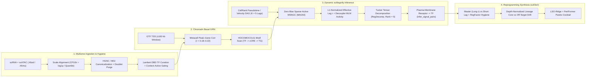

# Workflow Migration Guide: Multi-Scale Dynamic GRN & Developmental Reversal Pipeline (`scMagnify` × `scElixir`)

> [!IMPORTANT]
> This guide documents how to re-deploy the stabilized `scMagnify` (`v0.1.1-patched`, branch `scelixir-repro` in [`scMagnify-private`](file:///home/antigravity/thejimmychai/scMagnify-private)) + [`scElixir`](file:///home/antigravity/thejimmychai/scElixir_Claude_Hackerthon) multi-scale gene regulatory network (GRN) and cellular reprogramming pipeline on **any Linux/macOS/Cloud workstation** and how to migrate it cleanly to **new organs, species, or developmental/disease trajectories** (e.g., liver, kidney, heart, brain, hematopoiesis, or tumor plasticity).

---

## 1. End-to-End Pipeline Architecture



---

## 2. Reproducible Docker Environment (`scmagnify-scelixir:1.0`)

### 2.1 Build Targets (`core-cpu` and `gpu-cuda`)
All Python, C/Fortran, HDF5, PyTorch, Scanpy (`scipy==1.13.1`), CellRank, Decoupler (`decoupler>=2.1.0`), TensorLy (`tensorly==0.9.0`), and Google GenAI dependencies are pinned in [`Dockerfile`](file:///home/antigravity/thejimmychai/scMagnify-private/docker/Dockerfile) and [`requirements.scmagnify.txt`](file:///home/antigravity/thejimmychai/scMagnify-private/docker/requirements.scmagnify.txt).

```bash
# 1. Clone private stabilized scMagnify fork
git clone -b scelixir-repro https://github.com/thejimmychai/scMagnify-private.git
cd scMagnify-private

# 2. Build portable CPU image (runs anywhere: laptop, VM, CI, rootless containers)
docker build --target core-cpu -t scmagnify-scelixir:1.0 -f docker/Dockerfile .

# 3. (Optional) Build CUDA 12.4 GPU image for large full-atlas multi-seed runs
docker build --target gpu-cuda -t scmagnify-scelixir:1.0-gpu -f docker/Dockerfile .

# 4. Run full end-to-end deterministic verification & 9-test rootless pytest suite
docker run --rm scmagnify-scelixir:1.0 /workspace/docker/verify_scmagnify_env.py
docker run --rm --user $(id -u):$(id -g) -e HOME=/tmp scmagnify-scelixir:1.0 -m pytest /workspace/tests -v
```

> [!TIP]
> **Enterprise / Cloud Proxy TLS Certificates:** When running inside corporate VMs or cloud sandboxes that inspect outbound HTTPS traffic, mount the host CA bundle read-only (`-v /etc/ssl/certs:/etc/ssl/certs:ro`) so internal `pooch` / `scanpy` dataset downloads validate TLS certificates seamlessly.

### 2.2 Reference Motif, GTF & Signaling Cache (`Zenodo 17440841`)
Download once and volume-mount across all runs (`-v /path/to/scm_zen_cache:/opt/scmagnify_cache`):

```bash
mkdir -p /path/to/scm_zen_cache
curl -fL "https://zenodo.org/records/17440841/files/scmagnify_data.zip?download=1" \
  -o /path/to/scm_zen_cache/scmagnify_data.zip
# Verify MD5: a8d6c7712dd8b6fad7f6ce617d44c819
unzip -q /path/to/scm_zen_cache/scmagnify_data.zip -d /path/to/scm_zen_cache/
mv /path/to/scm_zen_cache/data /path/to/scm_zen_cache/scm_data
```

Contents of `scm_data/`:
- `annotations/hg38.cellranger.gtf.gz` & `mm10.cellranger.gtf.gz`
- `motifs/HOCOMOCOv11_HUMAN.pfm` & `HOCOMOCOv11_MOUSE.pfm`
- `tf_lists/allTFs_hg38.txt` & `allTFs_mm10.txt` (intersected strictly with official Lambert 2018 DNA-binding TFs `lambert2018_tf_names.txt`)
- `genesets/msigdb.v2025.1.Hs.symbols.gmt` & `msigdb.v2025.1.Mm.symbols.gmt`
- `rtf_nets/combined_RTF.parquet` (Receptor-to-TF prior network for `scm.tl.infer_signal_pairs`, filtered upstream to genuine plasma-membrane receptors)
- `fonts/Arial*.ttf` (Publication typography registered automatically at plot startup)

---

## 3. Twelve Critical Upstream Fixes & Speedups in `scMagnify-private` (`scelixir-repro`)

Vanilla `scMagnify` `v0.1.1` exhibits eleven numerical, memory, and API defects plus an $O(p \times q)$ dense CPU bottleneck on modern `anndata`/`decoupler`/`scanpy` stacks. All twelve are resolved and verified via 9 rootless unit tests in [`test_active_edge_isomorphism.py`](file:///home/antigravity/thejimmychai/scMagnify-private/tests/test_active_edge_isomorphism.py):

| # | Module | Defect in Upstream `v0.1.1` | Fix in `scelixir-repro` |
| :-: | :--- | :--- | :--- |
| **1** | [`_train.py`](file:///home/antigravity/thejimmychai/scMagnify-private/src/scmagnify/models/_train.py) | `best_model = self.model.state_dict()` stored a mutable live reference, neutralizing training-loss early stopping. | Deep-cloned detached CPU tensors `{k: v.detach().cpu().clone()}` at each new training loss minimum. |
| **2** | [`_train.py`](file:///home/antigravity/thejimmychai/scMagnify-private/src/scmagnify/models/_train.py) | `ensemble_network_activation = np.max(median_signed_coeffs, axis=0)` clamped purely repressive TFs (`[-0.45, -0.20, 0.0]`) to `0.0`. | Extracted signed weight at peak magnitude lag (`argmax(\|median_signed_coeffs\|)`), preserving transcriptional repressors in `decoupler` MLM. |
| **3** | [`_train.py`](file:///home/antigravity/thejimmychai/scMagnify-private/src/scmagnify/models/_train.py) | `estimate_lags` applied `F.normalize` to signed coefficients before summing, causing opposite-sign lags to cancel out of `[1, K]`. | Applied `F.normalize(torch.abs(...), p=1, dim=-1)`, guaranteeing true L1-probability effective lags $\tau \in [1, K]$. |
| **4** | [`_train.py`](file:///home/antigravity/thejimmychai/scMagnify-private/src/scmagnify/models/_train.py) | `_train_epoch` executed a redundant 2nd forward/backward pass per mini-batch for smoothness loss and mis-indexed `T_idx`. | Sorted batch `coeffs` directly by `T_batch` (`coeffs.index_select(0, t_order)`), eliminating the duplicate pass and enforcing mini-batch smoothness. |
| **5** | [`_train.py`](file:///home/antigravity/thejimmychai/scMagnify-private/src/scmagnify/models/_train.py) | `regulation_inference` allocated 3 simultaneous `(N × K × p × q)` 4D arrays in RAM (>24 GB on 2k cells). | Aggregated CV and medians directly over `(N, K, E)` active chromatin edges (~20× lower peak RAM, exact output). |
| **6** | [`_utils.py`](file:///home/antigravity/thejimmychai/scMagnify-private/src/scmagnify/models/_utils.py) | `partial_ordering` called `sc.tl.pca(adata, n_comps=50)` without `use_highly_variable=False`, crashing on `<50` HVGs or 2-feature subsets; $O(N^2)$ Python DAG loop. | Set `use_highly_variable=False`, bounded `n_comps = min(50, max(1, min(n_obs-1, n_vars-1)))`, and vectorized DAG masking (~1,000× speedup). |
| **7** | [`_tensor_decomp.py`](file:///home/antigravity/thejimmychai/scMagnify-private/src/scmagnify/tools/_tensor_decomp.py) | `RegDecomp.tucker_decomposition` used `range(rank[0])` instead of `range(factor1.shape[0])`, crashing whenever `rank != lag`. | Indexed `Lag` factor rows by `factor1.shape[0]` (`dec.data.uns["regfactors"]`). |
| **8** | [`_func_enrich.py`](file:///home/antigravity/thejimmychai/scMagnify-private/src/scmagnify/tools/_func_enrich.py) & [`_intracci.py`](file:///home/antigravity/thejimmychai/scMagnify-private/src/scmagnify/tools/_intracci.py) | `GENESET_DIR` and `RTF_NET_DIR` resolved only at import time, failing when `scm.settings.scm_data` was set in scripts. | Added dynamic runtime resolution from `scm.settings.scm_data` and `$SCMAGNIFY_DATA`. |
| **9** | [`requirements.scmagnify.txt`](file:///home/antigravity/thejimmychai/scMagnify-private/docker/requirements.scmagnify.txt) | `anndata>=0.10.9` removed `AlignedViewMixin` (`mudata==0.2.x` crash) while `mudata>=0.3` removed `write_h5mu`; SciPy `1.14+` removed `.A`. | Pinned `anndata==0.10.8`, `mudata==0.2.3`, `scipy==1.13.1`, `tensorly==0.9.0`, `decoupler>=2.1.0`, and replaced `.X.A` / `.A1` calls with safe helpers. |
| **10** | [`_train.py`](file:///home/antigravity/thejimmychai/scMagnify-private/src/scmagnify/models/_train.py) | Passing `time_key="velocity"` invoked `cr.kernels.VelocityKernel` in `partial_ordering` and then crashed on `adata_fil.obs["velocity"]`. | Resolved cell-ordering vector `T` cleanly via `latent_time` / `velocity_pseudotime` / `dpt_pseudotime` fallback when `time_key == "velocity"`. |
| **11** | [`_modules.py`](file:///home/antigravity/thejimmychai/scMagnify-private/src/scmagnify/models/_modules.py) & [`_train.py`](file:///home/antigravity/thejimmychai/scMagnify-private/src/scmagnify/models/_train.py) | Dense `(p × q)` `MSNGC` evaluation & generic `torch.norm` backward kernels spent ~88% of compute on zero-masked chromatin edges (`37.03 s/epoch` on CPU). | Parameterized `MSNGC.forward_active` over `chrom_constraint > 0` active edges + fused SIMD L1/L2 norms (**45.8× CPU speedup** to `0.81 s/epoch`, proven algebraically identical for identical active-edge parameters within `atol = 1e-6`). |
| **12** | [`_modules.py`](file:///home/antigravity/thejimmychai/scMagnify-private/src/scmagnify/models/_modules.py) & [`_train.py`](file:///home/antigravity/thejimmychai/scMagnify-private/src/scmagnify/models/_train.py) | Upstream `m.bias.data.fill_(0.1)` initialized final linear output biases to `+0.1`, creating zero-CV phantom edges on unexpressed TFs under moderate step budgets; `dc.mt.mlm(tmin=5)` crashed on sparse subsets. | Zero-initialized final-layer edge biases (`nn.init.zeros_(m.bias.data)`, keeping `0.01` on hidden ReLU layers) and set dynamic `tmin = min(5, max_tgs)`. |

---

## 4. Optimal Hyperparameters Reference Table

Validated across Human Hematopoiesis (`cd34_multiome`), Mouse Pancreas (`endocrinogenesis_day15`), Human Lung Development (`5 PCW–56.8 yr`), and Mouse Lung Development (`E12.5–7wk`):

| Stage / Component | Parameter | Optimal Value | Biological / Mathematical Role |
| :--- | :--- | :--- | :--- |
| **Cis-Chromatin Basal GRN** | `span` | `±100,000 bp` | Promoter + distal enhancer window around canonical GTF TSS |
| | `cor_cutoff` / `pval_cutoff` | `0.18–0.22` / `0.05` | Metacell ATAC peak–RNA correlation scaffold prior to Granger pruning |
| | `motif_db` | `HOCOMOCOv11` | Species-matched PWM scan + strict Lambert 2018 DNA-binding TF filter |
| | `context_active_gating` | `det >= 0.03, std >= 0.02` | Restricts active basal edges per epoch/lineage to expressed, variable TFs & targets |
| **Cell Ordering (`partial_ordering`)** | `time_key` | `"dpt_pseudotime"` or `"velocity"` | CellRank `PseudotimeKernel` (multi-cohort atlases) or `VelocityKernel` (single-batch spliced/unspliced) |
| | `lag` ($K$) | `5` | 5-step multi-scale diffusion operator capturing rapid ($\tau < 2.65$) vs pioneer ($\tau \ge 2.65$) lags |
| **Neural Granger (`scm.MAGNI`)** | `hidden` | `[50]` | Hidden width of each lag-specific self-explaining coefficient MLP (zero-bias output layer) |
| | `lmbd` ($\lambda$) | `3.0` | Hierarchical group-lasso + L1 sparsity penalty applied to attention-weighted edge coefficients |
| | `alpha` ($\alpha$) | `0.5` | Balance between lag-group L2 norm ($1-\alpha$) and elementwise L1 norm ($\alpha$) |
| | `gamma` ($\gamma$) | `0.02` | Adjacent-pseudotime mini-batch coefficient smoothness regularization |
| | `lr` / `batch_size` / `max_iter` | `1e-3` / `32` / `120–160` | ~3,500–5,100 gradient steps (`patience = 16–18`) ensuring full L1 pruning convergence |
| **Edge & Regulon Inference** | `cv_thres` | `0.20` | Prunes edges with high across-cell coefficient of variation ($\text{CV} \ge 0.2$) |
| | `filter` | `["quantile", 0.90, True]` | Retains top 10% causal edges for topological centrality & 3-ring subnetworks |
| | `acts_method` | `"mlm"` | Multivariate linear model regulon activity in `decoupler` using signed Granger weights |
| **Tensor Decomposition** | `tucker_rank` | `5` (`[5, 5, 5]`) | Decomposes `(Lag × TF × TG)` 3-way tensor into 5 coordinated `RegFactors` |

---

## 5. Step-by-Step Checklist for Migrating to a New Organ or Biological Question

### Step 1 — Prepare Clean, Scale-Aligned Multiome Inputs
1. **Audit normalization per cohort** before concatenating: never mix raw counts, single-`log1p`, double-`log1p`, and pre-z-scored matrices. Convert UMI matrices to `CP10k + log1p` (`layers["log1p_norm"]`) and keep integer counts in `layers["counts"]`. If integrating pre-z-scored snRNA cohorts, apply column-wise monotonic quantile alignment onto a modality-matched reference and pair with snATAC gene/peak accessibility to audit nuclear TF dropout.
2. **Canonicalize gene identifiers**: map Ensembl IDs and legacy aliases (`ARNTL -> BMAL1`, `H2AFZ -> H2AZ1`) to current HGNC (human) or MGI (mouse) symbols, merging duplicate columns in linear count space before `log1p`.
3. **Purge off-lineage doublets & tag technical artifacts**:
   - Remove heterotypic doublets (`PTPRC+` immune, `PECAM1+` endothelial, `COL1A1+` mesenchymal, `WT1+/UPK3B+` mesothelial when studying epithelium).
   - Restrict candidate regulators to **Lambert et al. (2018)** DNA-binding TFs (`lambert2018_tf_names.txt`), explicitly tagging non-DBD co-regulators (`YAP1, WWTR1, HOPX, ID2`) in a `regulator_class` column.
   - Exclude ribosomal/mitochondrial/ambient hemoglobin transcripts (`RPL*, RPS*, MT-*, HB*`) from target pools, flag dissociation immediate-early genes (`FOS, JUN, EGR1, ATF3, NR4A1`), and filter `combined_RTF.parquet` candidate receptors upstream to genuine plasma-membrane receptors before calling `scm.tl.infer_signal_pairs(..., num_perms=2000)`.

### Step 2 — Construct the Organ's Basal GRN (`TF -> cCRE -> TG`)
- **Case A (Paired Multiome or Matched Stage scRNA + scATAC Available — Recommended):**
  Aggregate into 30–80 metacells (`SEACells` or `celltype × age × leiden` pseudobulks), compute cis-peak-to-gene correlations within `±100 kb` of GTF TSSs (`cor > 0.18–0.22`), scan linked peaks with `HOCOMOCOv11` PWMs (`scm.tl.motif_scan` or pre-indexed PWM AnnData), and save both `basal_df` (`TF, Target, Score=1`) and `triples_df` (`TF, Peak, Target, cor`). Always run a pure-ATAC basal ablation alongside any hybrid literature/eGRN supplement to verify hub concordance.
- **Case B (scRNA-Only Trajectory with Public Reference ATAC Atlas):**
  Use cell-type-matched public ENCODE / CATlas / ChIP-Atlas enhancer-promoter + PWM links intersected with trajectory dynamic genes (`250–400` dynamic genes per branch).

### Step 3 — Run Within-Timepoint (Q1) and Cross-Timepoint Trajectory (Q2) `scMagnify`
Copy [`01_run_scelixir_lung_scmagnify.py`](file:///home/antigravity/thejimmychai/scMagnify-private/scelixir_lung/01_run_scelixir_lung_scmagnify.py) as your template and update three dictionaries:
1. `CURATED_<ORGAN>_GENES`: canonical progenitor, mature fate A/B/C markers, and plasma-membrane niche receptors.
2. `epoch_stage` mapping (`T1..Tk` chronological stages) for **Q1** (gating basal edges per epoch to expressed TFs, separating long-lag $\tau \ge 2.65$ master regulators from short-lag $\tau < 2.65$ rapid effectors, and combining `RegFactor` Tucker decomposition with stress/cell-cycle signature hygiene).
3. `lineage_specs` (`Progenitor -> Mature Fate_i`) for **Q2**: when combining whole-cell fetal scRNA with postnatal/adult nuclear snRNA, depth-normalize mean regulator expression within each fate column (`E_depth = E / E.mean(axis=0)`) before computing fate-specificity fold enrichment and ternary coordinates, and normalize locus-browser ATAC peak heights across cell types globally (`global_max_h`) rather than per track so differential enhancer opening is preserved.

### Step 4 — Register New Organ in `scElixir` Web/API Bundle
1. Export `GRN_network_scores_scmagnify.csv` (computing true directed `degree_in`, `degree_out`, and `degree_all` over `filtered_network`) into `scElixir_Claude_Hackerthon/data/organs/<organ_id>/` or `data/reference/`.
2. Add `("<organ_id>", "<layer_id>", "scmagnify")` to `GRN_COMPUTED` in [`config.py`](file:///home/antigravity/thejimmychai/scElixir_Claude_Hackerthon/backend/config.py).
3. Run contract tests:
   ```bash
   python3 -m unittest discover -s tests -v
   ```

---

## 6. Cloud Scale-Out (`Google AI Studio / Gemini Interactions API` + `Cloud Run GPU`)

When scaling to >50,000 cells, >1,000 dynamic genes, or 10-seed ensemble sweeps:

1. **Google AI Studio Developer Platform (`google-genai` Interactions & Batch APIs):**
   Use [`gemini_interactions_runner.py`](file:///home/antigravity/thejimmychai/scMagnify-private/cloud_gemini/gemini_interactions_runner.py) to dispatch asynchronous `background=True` agentic audit/code-execution jobs (`client.interactions.create`) with stateful `previous_interaction_id` chaining and structured JSON `REGFACTOR_AUDIT_SCHEMA`, or multi-lineage sweeps via `client.batches.create`:
   ```bash
   # Dry-run manifest generation (no API key needed)
   docker run --rm -v $PWD:/workspace scmagnify-scelixir:1.0 \
     -m cloud_gemini.gemini_interactions_runner --mode dry-run --output-dir /workspace/reproduce/cloud_manifests

   # Live background Interactions API execution (requires GEMINI_API_KEY)
   GEMINI_API_KEY="your_key" docker run --rm -e GEMINI_API_KEY \
     -v $PWD:/workspace scmagnify-scelixir:1.0 \
     -m cloud_gemini.gemini_interactions_runner --mode interactions \
     --grn-summary /workspace/scelixir_lung/results/lung_scmagnify_summary.json
   ```
2. **Containerized Multi-Seed GPU Execution (`Cloud Run Jobs` / Slurm / Kubernetes):**
   Deploy `scmagnify-scelixir:1.0-gpu` (`nvidia-l4` or `a100`) using [`deploy_cloud_run_gpu.sh`](file:///home/antigravity/thejimmychai/scMagnify-private/cloud_gemini/deploy_cloud_run_gpu.sh) and [`run_magnify_multiseed_worker.py`](file:///home/antigravity/thejimmychai/scMagnify-private/reproduce/run_magnify_multiseed_worker.py), where each parallel task shard receives `CLOUD_RUN_TASK_INDEX` (`seed = 42 + task_index`).
